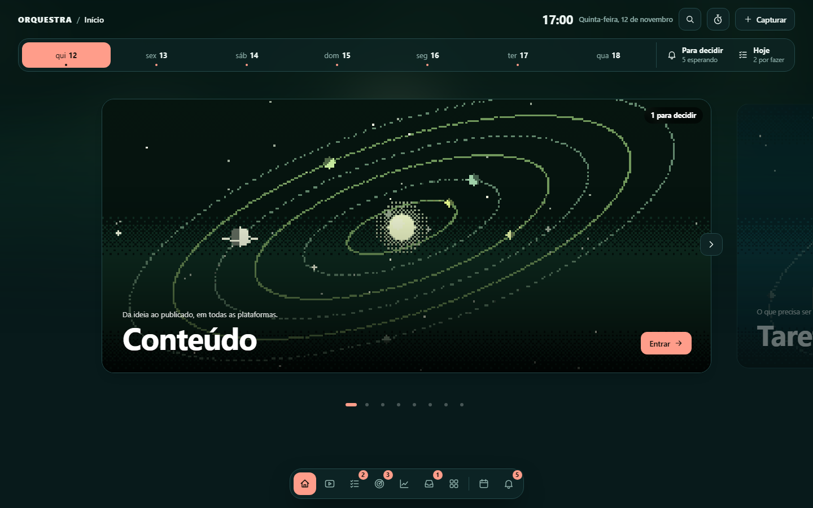
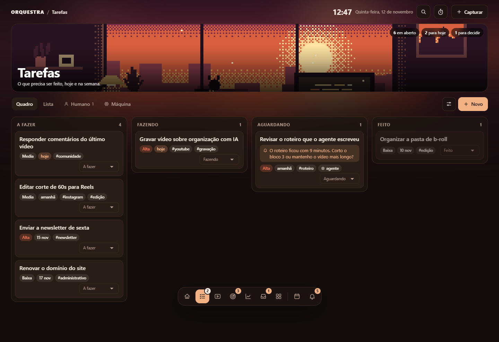
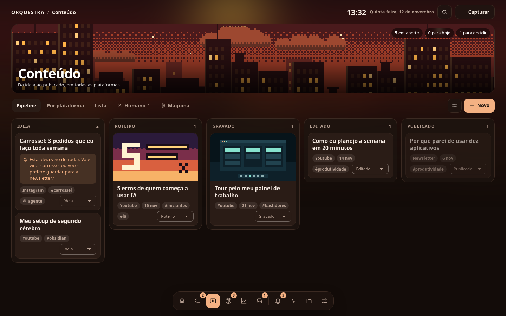

# Orquestra

**Um painel local para organizar seu trabalho em cima de uma pasta de arquivos markdown, com ou sem agentes de IA.**

Você já usa ChatGPT, Claude ou Gemini todo dia, mas cada conversa começa do zero e
nada fica organizado em lugar nenhum. O Orquestra resolve isso com uma ideia simples:
suas tarefas, seus projetos e suas anotações são arquivos de texto numa pasta. O
painel mostra essa pasta de um jeito bonito e rápido; seus agentes trabalham direto
nela; e você abre no Obsidian quando quiser.



- **Roda no seu computador.** O painel não exige conta nem envia suas notas para uma nuvem própria. Os dados são arquivos seus; coletores e agentes opcionais podem acessar serviços externos.
- **Aproveita o Obsidian que você já tem.** Aponte para o seu vault: nenhuma nota muda de lugar, e as pastas que você escolher viram quadros e listas.
- **Do seu jeito.** Comece pelo essencial, pelo método PARA, por um perfil de criador, de estudos ou de negócio. Depois mude tudo pela tela, sem escrever código: áreas, campos, tema, modo claro ou escuro, cor de destaque, cantos e letra.
- **Funciona com qualquer agente, e sem nenhum.** Claude, Codex, Gemini: basta dar acesso à pasta. As regras ficam num `AGENTS.md`. Quem só quer se organizar não precisa de IA.
- **Separa o que você disse do que a IA escreveu.** Um resumo da máquina nunca vira "fala sua".
- **Abre no celular** pela sua rede privada do Tailscale.

| Quadro de tarefas | Pipeline de conteúdo |
|---|---|
|  |  |

## Instalação

Leva uns dez minutos. Você precisa de duas ferramentas gratuitas: o **uv**
(instala o Python e as dependências sozinho) e o **git**.

### Windows

1. Abra o **PowerShell** e instale o uv:

   ```powershell
   powershell -ExecutionPolicy ByPass -c "irm https://astral.sh/uv/install.ps1 | iex"
   ```

2. Instale o git: baixe em <https://git-scm.com/download/win> e avance com as opções padrão.
3. **Feche e abra o PowerShell de novo**, para ele enxergar os dois.

### macOS e Linux

1. Abra o **Terminal** e instale o uv:

   ```bash
   curl -LsSf https://astral.sh/uv/install.sh | sh
   ```

2. Confira `git --version`. No macOS, o sistema oferece instalar as ferramentas de linha de comando. No Linux, instale o Git pelo gerenciador da sua distribuição (`sudo apt install git` em Debian/Ubuntu; `sudo dnf install git` em Fedora).
3. Feche e abra o Terminal de novo.

### Baixar e abrir (todos os sistemas)

```bash
git clone https://github.com/antoniogsouzaag/orquestra.git
```

```bash
cd orquestra
```

```bash
uv sync --locked
uv run --frozen orquestra
```

O navegador abre em <http://localhost:8420> e faz uma pergunta só:

- **Já tenho um vault do Obsidian.** O painel mostra os cofres que encontrou no seu
  Obsidian (ou você indica a pasta), olha o que há lá sem alterar nada e pergunta
  quais pastas você quer ver no painel.
- **Criar um vault novo.** Você escolhe a pasta, um ponto de partida e o tema.

Nos dois casos dá para dar nome ao painel, escolher o tema e marcar as áreas que
quer. Na primeira vez o `uv` baixa o que precisa e demora um pouco mais.

Para encerrar, `Ctrl+C` no terminal. Nas próximas vezes, `uv run --frozen orquestra`
inicia direto no vault escolhido; abra a URL mostrada no terminal. Para abrir o
navegador também nessas vezes, use `uv run --frozen orquestra iniciar --abrir`.

> Algo não funcionou? Rode `uv run --frozen orquestra doctor`. Ele confere a instalação e
> explica, em português, o que falta.

## Já usa o Obsidian?

Você não precisa reorganizar nada. Ao escolher o seu vault:

- **A preparação preserva suas notas no lugar.** O painel acrescenta os arquivos de configuração que faltam:
  `orquestra.yaml`, a pasta `_orquestra/` (temas) e o `AGENTS.md`. Se você já tem
  um `AGENTS.md`, o seu fica como está e o do painel vai para `AGENTS.orquestra.md`.
- **Suas pastas aparecem em "Pastas"**, navegáveis, do jeito que estão no disco.
- **Qualquer pasta da raiz pode virar área do painel** com um clique em "Mostrar no
  painel". O Orquestra lê os campos que suas notas já têm no topo (status, datas,
  tags) e monta lista e quadro a partir deles. O único arquivo criado é um
  `_modulo.yaml` dentro da pasta.
- **O painel reconhece os jeitos mais comuns de organizar** (PARA, Zettelkasten,
  Johnny Decimal, ACE, diário) e sugere a partir daí.
- **O histórico em git fica desligado** até você ligar, para não interferir com
  OneDrive, iCloud, Obsidian Sync ou um git que você já use.

Detalhes em [docs/vault-existente.md](docs/vault-existente.md).

## O que vem pronto

Um vault novo nasce de um **perfil**, que é só uma lista de áreas. Depois você
acrescenta e tira áreas à vontade, em Ajustes.

| Perfil | Áreas |
|---|---|
| **Essencial** | Tarefas, Notas, Entrada |
| **Criador de conteúdo** | Tarefas, Conteúdo, Radar, Números, Entrada |
| **PARA** | Projetos, Áreas, Recursos, Arquivos, Entrada |
| **Negócio ou freelancer** | Tarefas, Clientes, Projetos, Finanças, Entrada |
| **Estudos** | Tarefas, Estudos, Recursos, Entrada |
| **Em branco** | nenhuma: você monta |

As telas e áreas disponíveis dependem do perfil e do que você acrescentar em Ajustes:

| | |
|---|---|
| **Entrada** | Quando a área de captura está configurada, anote do celular e organize depois (você ou um agente). |
| **Decidir** | Uma fila só com tudo que espera você, incluindo perguntas dos agentes. |
| **Números** | Área opcional com uma nota por dia e um gráfico de cada número que você acompanha. |
| **Pastas** | O vault como ele é no disco, inclusive o que não é área do painel. |
| **Diário** | O que mudou no vault e o que cada agente fez, com autor e horário. |
| **Temas** | Três temas, cada um com o seu estilo de capas em pixel art animadas (nove cenas desenhadas por código), em modo claro e escuro. |
| **Automações sem IA** | Tarefas recorrentes, agenda, cotações e feeds: scripts que você revisa, aprova e pode agendar. Serviços externos podem ter limites ou custos. |

## Primeiros passos

1. **Olhe em volta.** Arraste um cartão no quadro, abra uma nota, aperte `C` para capturar uma ideia.
2. **Ajuste as áreas.** Em **Ajustes**, acrescente uma área pronta, crie uma em branco ou tire do painel o que não usa (a pasta fica). O ícone ao lado das abas de cada área abre **Personalizar**: nome, ícone, capa, campos e opções.
3. **Diga quem você é.** Em cada área, a aba **Humano** guarda o que você decide: como prioriza, sua voz, o que te interessa. É o que os agentes leem antes de agir.
4. **Conecte um agente** (opcional). Abra o Claude Code ou o Codex na pasta do vault e peça: "leia o AGENTS.md e processe a minha entrada". Veja [docs/agentes.md](docs/agentes.md). Para apps de conversa, use o [conector MCP](docs/mcp.md).
5. **Revise e aprove os coletores** (opcional). Scripts executam com as permissões da sua conta. A aprovação local vale para uma versão de código e configuração; depois, escolha se quer agendamento. Veja [docs/coletores.md](docs/coletores.md).
6. **Abra no celular.** Siga [docs/tailscale.md](docs/tailscale.md).

## Como funciona

```
seu vault/
  AGENTS.md            as regras que todo agente lê
  orquestra.yaml       nome, tema, backup
  tarefas/             uma área (módulo)
    _modulo.yaml       campos, status, visões
    itens/             uma nota .md por tarefa
    humano/            o que VOCÊ disse (agentes leem, não reescrevem)
    maquina/           instruções e aprendizados dos agentes, coletores
  Minhas Pastas/       qualquer pasta sua; vira área com um _modulo.yaml dentro
  diario/              o que mudou e o que os agentes fizeram
  _orquestra/temas/    cores e capas
```

Uma tarefa é só isto:

```markdown
---
status: a_fazer
prioridade: alta
data: 2026-01-15
origem: humano
---

Gravar o vídeo principal da semana.
```

Você edita no painel, no Obsidian ou pede a um agente: é o mesmo arquivo. O painel
confere a versão antes de gravar e avisa quando encontra uma alteração externa.
Mudanças no disco costumam aparecer em cerca de um segundo, dependendo do disco
e da carga do computador.
Em conflito, você pode copiar o rascunho ou salvá-lo como outra nota. Rascunhos
pendentes também ficam neste navegador, separados por vault e por aba; armazenamento
privado, quota ou limpeza do navegador podem impedir essa recuperação.

As gravações preservam versões de recuperação fora do vault, em
`~/.orquestra/recuperacao/`. Isso reduz o risco de perder uma edição, mas não impede
que outro programa sobrescreva um arquivo depois. Evite duas edições simultâneas
da mesma nota e mantenha uma cópia externa. Veja [recuperação e backup](docs/backup.md).

### Humano e máquina

É a regra que mais importa. Em cada área:

- `humano/` guarda o que você disse ou decidiu. Agentes leem sempre e nunca reescrevem.
- `maquina/` guarda o que faz o sistema andar: instruções, scripts e os **aprendizados**.
- Toda nota tem um campo `origem` (`humano`, `agente` ou `coletor`). Nota sem `origem` é sua.

Sem isso, depois de algumas semanas ninguém sabe mais o que foi ideia sua e o que
foi um resumo que a IA fez de uma ideia sua.

### Agentes que melhoram a cada rodada

Cada área tem um `maquina/aprendizados.md`. Todo agente lê antes de começar e
acrescenta uma linha ao terminar, quando aprendeu algo que vale para a próxima vez:
uma correção sua, o que rendeu, o que evitar. O trabalho deixa de se repetir igual.

### Coletar é script, decidir é IA

Buscar os vídeos novos de um canal não precisa de inteligência: um script pode
fazer a coleta após sua aprovação. A IA entra depois, para dizer quais valem o seu tempo. Os coletores
do Orquestra são scripts Python pequenos, que você pode ler e adaptar.

O Orquestra não tenta substituir os conectores que os agentes já têm (e-mail,
agenda, documentos). Quem faz a ação é o agente; o vault é onde fica o registro.

## Comandos

Rode dentro da pasta do aplicativo, onde estão `pyproject.toml` e `uv.lock`, depois
de `uv sync --locked`. O vault fica em outra pasta. Para conferir os argumentos:

```bash
uv run --frozen orquestra --help
uv run --frozen orquestra iniciar --help
uv run --frozen orquestra confiar --help
```

| Comando | O que faz |
|---|---|
| `uv run --frozen orquestra` | Inicia o painel; na primeira vez, abre a escolha do vault |
| `uv run --frozen orquestra iniciar --abrir` | Inicia e abre o navegador também nas próximas vezes |
| `uv run --frozen orquestra iniciar --porta 8421` | Escolhe outra porta local para esta execução |
| `uv run --frozen orquestra criar "PASTA NOVA" --perfil essencial --sem-exemplos` | Cria um vault essencial sem exemplos; omita `--sem-exemplos` para incluí-los |
| `uv run --frozen orquestra adotar "PASTA EXISTENTE"` | Prepara uma pasta existente, preservando suas notas |
| `uv run --frozen orquestra doctor` | Diagnostica instalação, vault, Git e acesso remoto disponível |
| `uv run --frozen orquestra coletar radar` | Roda os coletores aprovados do Radar; omita `radar` para todos |
| `uv run --frozen orquestra confiar coletor radar rss.py` | Mostra assinatura e arquivos do coletor para revisão local |
| `uv run --frozen orquestra confiar backup` | Mostra configuração e destinos do histórico para revisão local |
| `uv run --frozen orquestra backup --enviar` | Cria snapshot e envia ao remoto aprovado; omita `--enviar` para manter local |
| `uv run --frozen orquestra mcp --vault "PASTA DO VAULT"` | Inicia MCP por stdio; o cliente MCP deve iniciar esse processo |
| `uv run --frozen orquestra autostart ativar` | Configura o início automático; também aceita `status` e `desativar` |
| `uv run --frozen orquestra iniciar --vault "OUTRO VAULT"` | Abre outro vault e passa a lembrá-lo como padrão |

Os caminhos entre aspas são exemplos: substitua pelo caminho completo desejado.
`--vault` seleciona o destino dos comandos existentes, como `doctor`, `mcp`,
`coletar`, `backup` e `confiar`; em `criar` e `adotar`, o destino é o argumento
posicional `caminho`. Os aliases `init` e `diagnostico` equivalem a `criar` e `doctor`.
Não use `--vault` com `criar`/`init` ou `adotar`: esses comandos recusam a opção
para evitar criar ou preparar uma pasta diferente da desejada.

`autostart status` e `autostart desativar` funcionam mesmo se o vault anterior
não existir mais. Em scripts, código de saída `0` indica conclusão sem erro,
`1` indica falha de operação/diagnóstico e `2` indica argumentos inválidos.
Avisos do `doctor` são mostrados no relatório e, sozinhos, não geram saída `1`.

Consultar `confiar` não aprova execução. Leia os arquivos apresentados e repita o
comando com `--assinatura HASH` usando a assinatura revisada. `--revogar` retira
a autorização. As instruções completas estão nos guias de [coletores](docs/coletores.md)
e [backup](docs/backup.md).

Para trocar de vault com o painel aberto: Ajustes > Vault > Trocar de vault.

## Documentação

| | |
|---|---|
| [Usar um vault que já existe](docs/vault-existente.md) | O que o painel cria, como as pastas viram áreas, estilos reconhecidos |
| [Módulos](docs/modulos.md) | Áreas prontas, personalizar pela tela e a referência do `_modulo.yaml` |
| [Conectar agentes](docs/agentes.md) | Claude Code, Codex, Gemini e o que pedir a eles |
| [Conector MCP](docs/mcp.md) | O vault como ferramenta para apps de conversa |
| [Celular com Tailscale](docs/tailscale.md) | Acesso remoto sem expor nada à internet |
| [Temas e aparência](docs/temas.md) | Claro e escuro, cor de destaque, cantos, letra, capas e como criar um tema |
| [Coletores](docs/coletores.md) | As automações gratuitas que vêm prontas e como escrever a sua |
| [Histórico e backup](docs/backup.md) | Versões locais quando algo muda, envio diário, e como desfazer |
| [Arquitetura](docs/arquitetura.md) | Como o código está organizado, para estudar ou contribuir |

## Segurança, em três linhas

- O painel **não tem senha** e escuta só no seu computador (`127.0.0.1`). Escolher ou trocar de vault e aprovar código exigem acesso local direto. Não publique a porta nem encaminhe localhost por um proxy público.
- No celular, use **`tailscale serve`**. **Nunca** use `tailscale funnel` nem abra a porta no roteador.
- Chaves de API ficam em `~/.orquestra/.env`, **fora** do vault; copie o [.env.example](.env.example) para esse destino se precisar. URLs privadas de calendários também são segredos. Mantenha o backup em repositório **privado** e confira [SECURITY.md](SECURITY.md).

## Estado do projeto

As correções de segurança, recuperação, desempenho e qualidade da versão 0.4 estão
descritas em [Preparação para produção](docs/preparacao-producao-2026-11-11.md), com
testes executados e os limites de validação de cada plataforma.

O refinamento de formulários, alertas, navegação e primeira experiência está em
[Revisão de UI e UX](docs/revisao-ui-ux-2026-11-11.md), com capturas e validação.

A verificação dos comandos, instalação, MCP e exemplos dos guias está em
[Revisão de comandos e MCP](docs/revisao-comandos-mcp-2026-11-11.md).

Versão 0.4. Funciona e tem testes automatizados, mas é novo: faça backup.

- Testado no **Windows 10** com Chrome. macOS e Linux usam o mesmo código, mas ainda não foram testados em máquina real; relatos são bem-vindos.
- A leitura da lista de cofres do Obsidian, o acesso por Tailscale e o início automático no macOS/Linux foram escritos seguindo a documentação de cada sistema e ainda precisam de confirmação de quem usa.
- Só pastas da raiz do vault viram área do painel; subpastas aparecem dentro da área e em "Pastas".

O que vem depois: arquivos `.base` para as visões aparecerem também no
Obsidian, conector MCP remoto (para apps no celular), mais cenas e um guia para
compartilhar módulos.

## Contribuir

O código é comentado em português e feito para ser lido. Comece pelo
[CONTRIBUTING.md](CONTRIBUTING.md) e por [docs/arquitetura.md](docs/arquitetura.md).

```bash
uv sync --locked
uv run --frozen python -m pytest
uv run --frozen ruff check src tests scripts
node --test tests/js/*.test.cjs
```

Ideias, problemas e módulos novos são bem-vindos nas issues.

## Licença

[MIT](LICENSE). Use, modifique e distribua à vontade.
