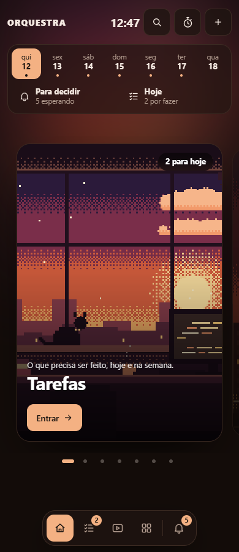
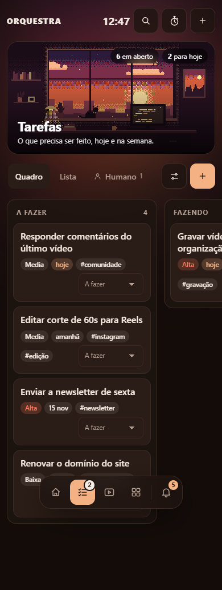
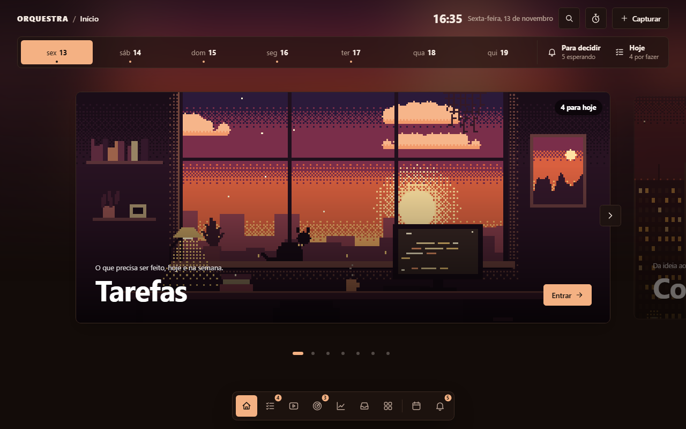
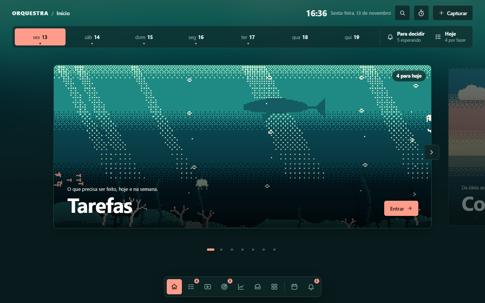
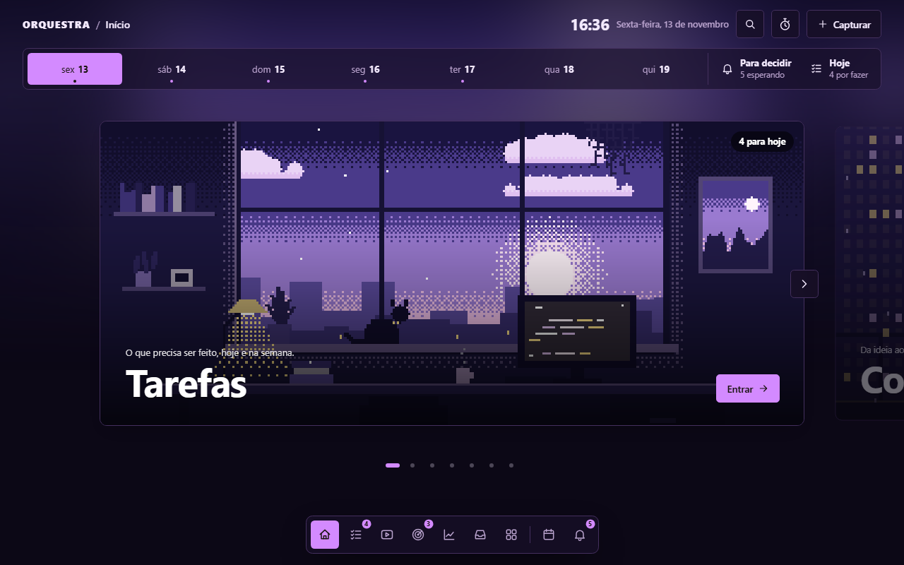
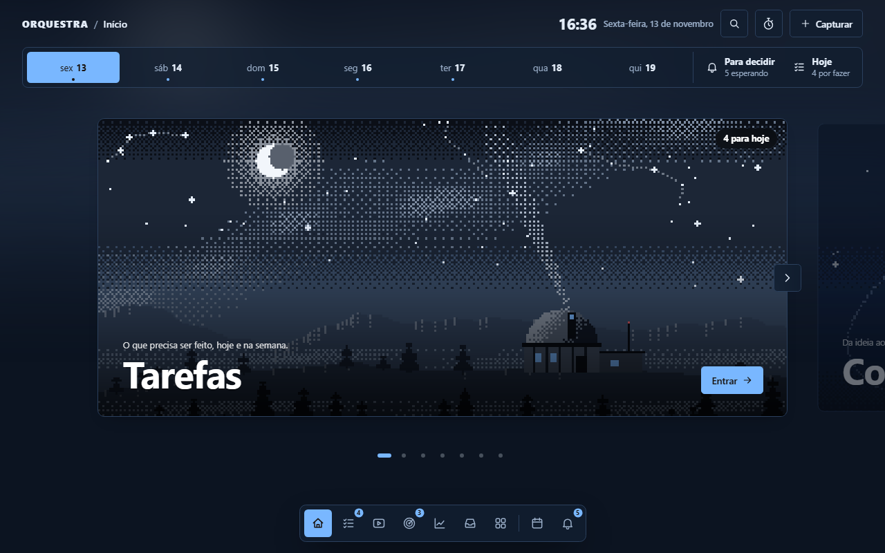
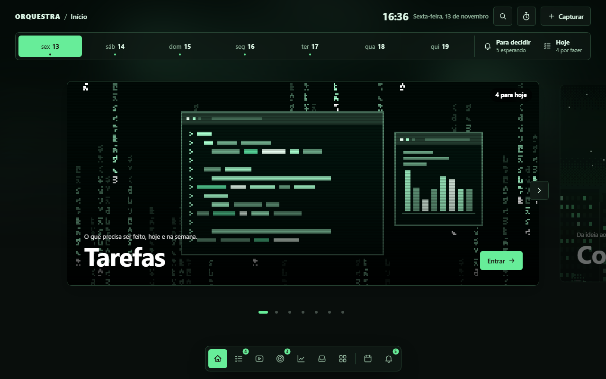
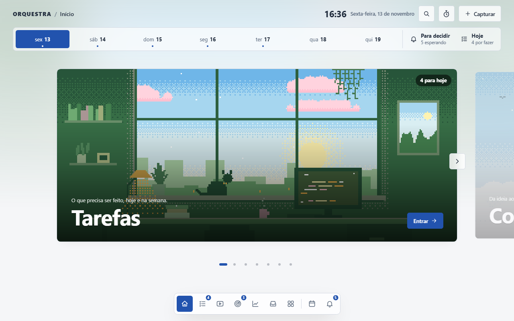
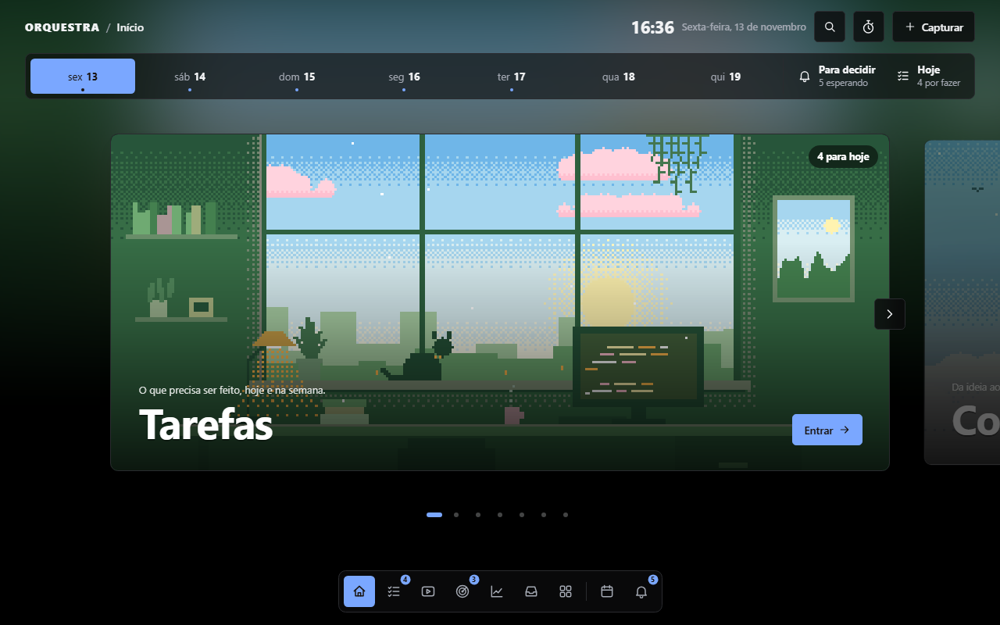
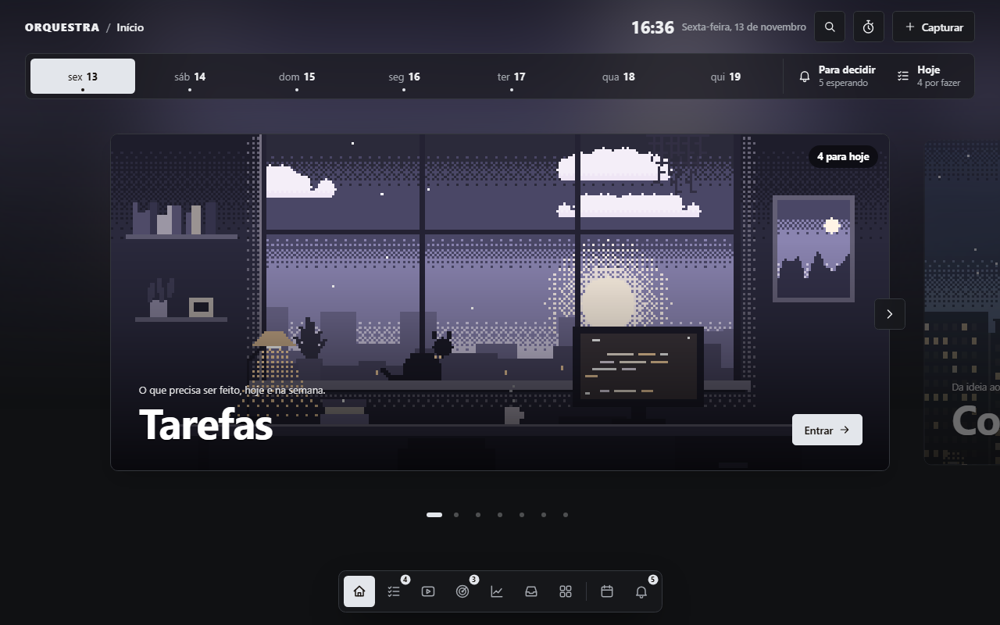

# Orquestra

**Suas notas em Markdown viram um painel de trabalho, no seu computador.**

[](https://github.com/aglabsrv-sys/orquestra/actions/workflows/qualidade.yml)


[](LICENSE)

O Orquestra lê uma pasta de arquivos Markdown (um vault do Obsidian, por exemplo)
e mostra tarefas, projetos, conteúdo, agenda e hábitos em quadros, listas e
calendários. Cada item continua sendo um arquivo `.md` comum: você edita no painel,
no Obsidian ou pede a um agente de IA, e é sempre o mesmo arquivo.


| Tarefas · tema Luz, destaque rosa | Conteúdo · tema Brasa |
|---|---|
|  |  |

<details>
<summary>No celular</summary>

| Início · Luz | Tarefas · Brasa |
|---|---|
|  |  |

</details>

As capturas usam um vault de demonstração com notas fictícias.

## Por que usar

- **Seus arquivos, no seu computador.** Sem conta e sem nuvem própria. O painel
  escuta só em `localhost`; as notas são arquivos que você pode abrir em qualquer editor.
- **Funciona com o vault que você já tem.** Nenhuma nota muda de lugar. Você escolhe
  quais pastas aparecem no painel.
- **Com agentes de IA, ou sem nenhum.** Claude, Codex, Gemini ou qualquer agente que
  leia uma pasta. As regras ficam num `AGENTS.md`; quem só quer se organizar não precisa de IA.
- **O que é seu fica separado do que a IA escreveu.** Cada nota diz quem a criou, e a
  pasta `humano/` guarda as suas decisões, que os agentes leem e não reescrevem.
- **Do seu jeito, pela tela.** Áreas, campos, sete temas com capas animadas em pixel
  art, modo claro ou escuro, cor de destaque, cantos e letra.

## Instalação

Você precisa de duas ferramentas gratuitas: o [uv](https://docs.astral.sh/uv/)
(que cuida do Python) e o [Git](https://git-scm.com/).

<details>
<summary><b>Windows</b></summary>

No PowerShell:

```powershell
powershell -ExecutionPolicy ByPass -c "irm https://astral.sh/uv/install.ps1 | iex"
```

Instale o Git em <https://git-scm.com/download/win> com as opções padrão. Depois
feche e abra o PowerShell.

</details>

<details>
<summary><b>macOS e Linux</b></summary>

No Terminal:

```bash
curl -LsSf https://astral.sh/uv/install.sh | sh
```

Confira `git --version`. No macOS o sistema oferece instalar o Git; no Linux use o
gerenciador da distribuição (`sudo apt install git`, `sudo dnf install git`). Depois
feche e abra o Terminal.

</details>

Com as duas instaladas, em qualquer sistema:

```bash
git clone https://github.com/aglabsrv-sys/orquestra.git
cd orquestra
uv run --frozen orquestra
```

O último comando é o único que você vai usar no dia a dia: na primeira vez ele
instala o Python e as dependências sozinho (demora um pouco mais) e, nas outras,
só abre o painel. O navegador abre em <http://localhost:8420>. Na primeira vez, escolha entre:

- **Já tenho um vault do Obsidian:** o painel lista os cofres que encontrou, olha a
  pasta sem alterar nada e pergunta quais pastas você quer ver.
- **Criar um vault novo:** escolha a pasta, um ponto de partida e o tema.

Nas próximas vezes, `uv run --frozen orquestra` abre direto no vault escolhido.
Para pegar uma versão nova, `uv run --frozen orquestra atualizar`. Para encerrar o
painel de qualquer terminal (mesmo se foi aberto por um agente),
`uv run --frozen orquestra parar`; `status` e `reiniciar` também existem.
Se algo não funcionar, rode `uv run --frozen orquestra doctor`: ele confere a
instalação e explica, em português, o que falta.

## O que vem pronto

| | |
|---|---|
| **Áreas** | Tarefas, Conteúdo, Projetos, Clientes, Finanças, Estudos, Radar, Números, Entrada e outras, em quadro, lista ou gráfico. Qualquer pasta sua também pode virar área. |
| **Decidir** | Uma fila com tudo que espera você, inclusive perguntas dos agentes. |
| **Agenda** | Mês, semana, dia e lista; compromissos gravados no vault e leitura de calendários iCal. |
| **Hábitos e Pomodoro** | Metas semanais com marcação diária, e um timer de foco que continua ao navegar. |
| **Pastas** | O vault como está no disco, com árvore, grafo de ligações (forças ajustáveis como no Obsidian), imagens, vídeos e HTML. |
| **Busca** | Ctrl+K (ou /) abre uma busca flutuante por cima de qualquer tela, com resultados enquanto você digita. |
| **Diário** | O que mudou no vault e o que cada agente fez, com autor e horário. |
| **Resumo do dia** | Prazos, decisões, hábitos e atividade de um dia numa visão compacta. |
| **Links do cofre** | Referências, anexos e blocos verificados, com notas futuras separadas do que precisa de revisão. |
| **Automações** | Recorrências, agenda, cotações e feeds, sem IA, na pasta que você escolher. São scripts pequenos e legíveis que rodam com a sua aprovação. |
| **Histórico** | Versões locais em Git a cada mudança e, se quiser, backup num repositório privado. |
| **Celular** | Acesso pela sua rede privada do [Tailscale](docs/tailscale.md), sem expor nada à internet. |

Um vault novo começa de um perfil (**Essencial**, **Criador de conteúdo**,
**Negócio**, **PARA** ou **Estudos**). Depois você acrescenta e tira áreas em **Ajustes**.

### Temas

Sete temas, cada um com paletas e um estilo de capas próprio, em modo claro e escuro.
As capas são cenas em pixel art desenhadas pelo navegador e animadas; também dá para
usar uma imagem ou um vídeo seu.

| Brasa | Maré | Noturno | Azul profundo |
|---|---|---|---|
|  |  |  |  |
| **Terminal** | **Luz** | **Luz (escuro)** | **Grafite** |
|  |  |  |  |

Veja [Temas e aparência](docs/temas.md) para criar o seu.

## Como funciona

```text
seu vault/
  AGENTS.md            as regras que todo agente lê
  orquestra.yaml       nome, tema e preferências do painel
  tarefas/             uma área
    _modulo.yaml       campos, status e visões
    itens/             uma nota .md por tarefa
    humano/            o que você disse (agentes leem, não reescrevem)
    maquina/           instruções, aprendizados e automações
  diario/              o que mudou e quem mudou
  _orquestra/temas/    cores e capas
```

Uma tarefa é só um arquivo:

```markdown
---
status: a_fazer
prioridade: alta
data: 2026-01-15
origem: humano
---

Gravar o vídeo principal da semana.
```

Para editar, dê dois cliques no texto da nota: ele fica editável ali mesmo, com a
mesma aparência, e só os blocos que você mudar são reescritos no arquivo
(veja [Editar uma nota](docs/pastas.md#editar-uma-nota)).

O painel confere a versão antes de gravar, avisa quando o arquivo mudou por fora e
guarda versões de recuperação em `~/.orquestra/recuperacao/`. Detalhes em
[Histórico e backup](docs/backup.md).

**Com agentes:** abra o Claude Code ou o Codex na pasta do vault e peça "leia o
AGENTS.md e processe a minha entrada". Para apps de conversa, use o
[conector MCP](docs/mcp.md): além de criar e atualizar itens com as regras
aplicadas pelo código, ele reúne o panorama de pendências, o contexto de uma área,
possíveis duplicados e os links de cada nota, sem alterar nada. Cada área tem um
`maquina/aprendizados.md` que os agentes leem antes de começar e completam ao terminar.

## Documentação

| Guia | Para quê |
|---|---|
| [Vault existente](docs/vault-existente.md) | Usar suas notas sem reorganizar nada |
| [Módulos](docs/modulos.md) | Áreas prontas, personalização e o `_modulo.yaml` |
| [Temas e aparência](docs/temas.md) | Cores, capas, cenas e como criar um tema |
| [Agentes](docs/agentes.md) e [MCP](docs/mcp.md) | Claude, Codex, Gemini e apps de conversa |
| [Automações](docs/coletores.md) | As automações prontas e como escrever a sua |
| [Pastas e links](docs/pastas.md) | Árvore, grafo e [verificação de links](docs/vinculos.md) |
| [Agenda](docs/agenda.md) e [Pomodoro e hábitos](docs/foco-e-habitos.md) | Compromissos, iCal, foco e metas |
| [Histórico e backup](docs/backup.md) | Versões locais, backup e como desfazer |
| [Celular](docs/tailscale.md) | Acesso remoto com Tailscale |
| [Comandos](docs/comandos.md) | Todos os comandos, início automático e remoção |

O [índice completo](docs/README.md) reúne os demais guias. As mudanças ficam no
[CHANGELOG](CHANGELOG.md).

## Segurança e privacidade

- O painel **não tem senha** e escuta só em `127.0.0.1`. Não publique a porta nem
  encaminhe `localhost` por um proxy público.
- No celular, use `tailscale serve`. **Nunca** `tailscale funnel` ou porta aberta no roteador.
- Chaves de API e URLs privadas de calendário ficam em `~/.orquestra/.env`, fora do
  vault. Mantenha o backup em repositório **privado**.

Para relatar uma vulnerabilidade, veja [SECURITY.md](SECURITY.md).

## Contribuir

Issues e pull requests são bem-vindos. O código é comentado em português e feito
para ser lido: comece pelo [CONTRIBUTING.md](CONTRIBUTING.md) e pela
[arquitetura](docs/arquitetura.md).

```bash
uv sync --locked
uv run --frozen python -m pytest -q
uv run --frozen ruff check src tests scripts .github/scripts
```

## Créditos

O Orquestra começou com o **Claude Fable 5.2**, cresceu em parceria com o
**GPT 6.1 Sol** e ganhou temas, capas e acabamento com o **Claude Opus 5.5**,
sempre com o **Antonio Garcia** na direção.

Feito com carinho por Antonio Garcia, Claude Fable 5.2, GPT 6.1 Sol e Claude Opus 5.5 · **AG LABS**.

## Licença

[MIT](LICENSE): use, modifique e distribua à vontade.
