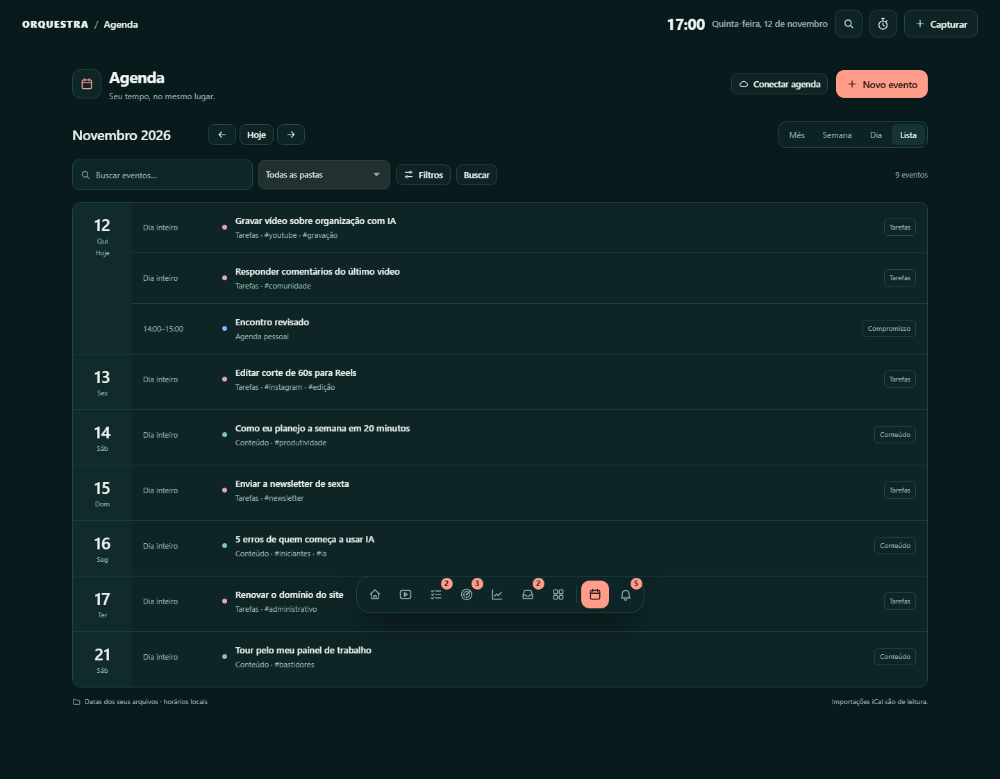
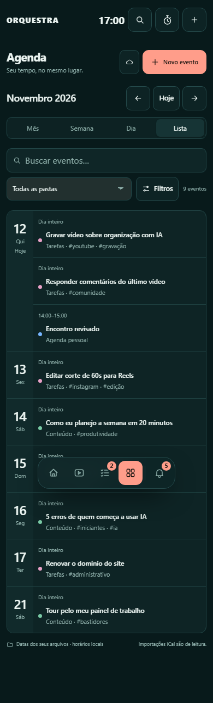

# Agenda

Acesso pelo botão Agenda do menu inferior ou pelos dias da home. A agenda reúne
itens com data das pastas do painel; as notas continuam sendo a fonte dos dados.

## Visões

- **Mês:** grade de seis semanas, eventos por dia e acesso aos itens adicionais.
- **Semana:** sete dias com régua de horários, eventos sobrepostos em faixas
  distintas e itens sem horário em uma seção fixa.
- **Dia:** a mesma grade, com espaço para os detalhes dos compromissos selecionados.
- **Lista:** eventos do mês selecionado, agrupados por dia.

Hoje, anterior e próximo navegam conforme a visão. O período, a busca e os filtros
ficam na URL, que pode ser salva nos favoritos. As trocas usam navegação parcial
quando o JavaScript está ativo; os links continuam funcionando sem ele.

A busca considera título, descrição, categoria, pasta e tags, sem exigir acentos.
Há filtros por pasta, categoria, cor e tag. Itens concluídos ficam ocultos até
marcar Incluir concluídos. Para preservar o desempenho, uma resposta mostra até
500 eventos e avisa quando é necessário refinar os filtros.

## Criar e editar

Novo evento abre um formulário compacto com título, início, término, dia inteiro,
categoria, cor, descrição e tags. Clicar em um horário preenche esse horário. Os
novos compromissos são notas em `agenda/itens/`; o módulo Agenda pessoal é criado
no primeiro evento. Nenhuma pasta ou nota existente é movida.

Se já houver uma pasta `agenda` com outro formato, o painel não a sobrescreve.
Use Pastas para entender/adaptar a estrutura antes de criar os novos compromissos.

Selecionar um evento abre a edição da nota original, inclusive para tarefas e
conteúdo de outras pastas. A data é gravada no campo de data configurado por essa
pasta. Seus outros campos permanecem. Abrir nota leva ao editor completo.

Arrastar para outro dia preserva a duração. Arrastar para uma faixa de horário
também ajusta a hora; um item sem horário recebe uma hora de duração. Pelo celular
ou teclado, o formulário permite a mesma alteração sem depender do arraste.
Arquivar move a nota para `arquivo/`, com confirmação; não exclui o arquivo.

Todas as alterações conferem a versão lida. Se o Obsidian ou um agente alterar o
arquivo enquanto o formulário está aberto, a gravação é recusada e o formulário
continua disponível. Escape/cancelamento pede confirmação quando há alterações.

## Datas e importações

Datas e horários são civis locais: `data: AAAA-MM-DD`, `hora: HH:MM`, `data_fim`
e `hora_fim`. Ausência de hora significa dia inteiro. O término com horário é
exclusivo: terminar à meia-noite não ocupa o dia seguinte. Eventos de dia inteiro
incluem as duas datas. Um compromisso pode ocupar até 366 dias.

Notas com hora e sem término válido usam uma hora de duração para a apresentação.
Isso não altera o arquivo enquanto você não editar/reagendar o item. Compromissos
do antigo coletor iCal com hora no título são reconhecidos quando a origem do
coletor está identificada na nota.

Conectar agenda mantém o assistente iCal e as limitações documentadas em
[Experiência da comunidade](experiencia-comunidade.md). Alterar um compromisso
importado aqui modifica o Markdown local; não altera o Google Agenda ou iCloud.
RRULE e sincronização bidirecional não foram adicionados nesta etapa.

## Implementação e referência

Referência visual e funcional: [Event Manager, de Vaibhav Kumar Singh (@vaib215)](https://21st.dev/@vaib215/components/event-manager).

O calendário usa os templates Jinja, os temas e os controles existentes do
Orquestra, com JavaScript progressivo. CSS e lógica da agenda são arquivos próprios;
o backend de apresentação fica em `calendario.py`, separado do agendador de coletores.
Não há dependências novas de frontend nem um banco paralelo de eventos.

## Interface

