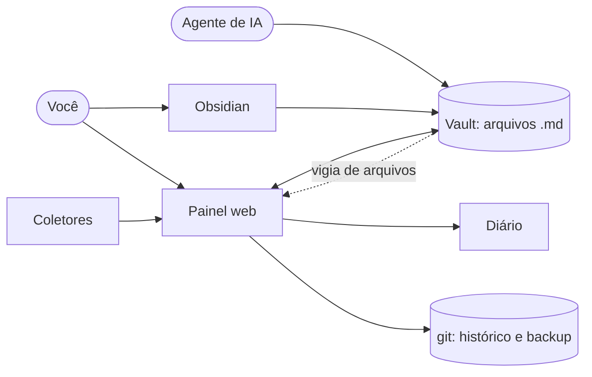

# Arquitetura (para quem vai estudar ou contribuir)

## A ideia em uma frase

O banco de dados é uma pasta de arquivos markdown. O painel é só uma janela para
ela, e qualquer coisa que saiba ler e gravar arquivos (você, o Obsidian, um agente
de IA, um script) participa do sistema em pé de igualdade.



## Decisões e por quê

| Decisão | Por quê |
|---|---|
| Arquivos, não banco de dados | Nenhum formato fechado. Funciona com Obsidian, com git e com qualquer agente, hoje e daqui a dez anos. |
| Módulos, temas e coletores dentro do vault | Personalizar é editar um arquivo, coisa que um agente faz. Atualizar o app nunca desfaz a personalização. |
| Vault fora do repositório do app | `git pull` do app nunca conflita com os dados; o vault tem o próprio git, privado. |
| Python + uv, um runtime só | Coletores e painel na mesma linguagem; o `uv` instala até o Python. |
| HTML no servidor e JavaScript puro | Sem etapa de build. O que está em `static/` é o que roda; dá para ler e mexer. |
| ruamel.yaml em vez de PyYAML | Preserva comentários, ordem e aspas do frontmatter. Editar um campo não reescreve o arquivo. |
| Índice em memória | Rápido e descartável. A verdade está no disco; o índice se refaz ao iniciar. |
| Coletor imprime JSON | O script não conhece o painel. Simples de escrever e de testar sozinho. |
| Agendador dentro do servidor | Igual em Windows, macOS e Linux, sem cron nem Agendador de Tarefas. |
| Sem login, escutando só em 127.0.0.1 | Menos coisa para dar errado. O acesso remoto fica com o Tailscale, que já resolve identidade. |

## Mapa do código

```
src/orquestra/
  notas.py         ler e gravar .md com frontmatter (escrita atômica, versão, conflito)
  modulos.py       _modulo.yaml: schema, conversão e validação de valores
  indice.py        espelho do vault em memória; resumos e busca
  painel.py        o núcleo: toda operação que altera o vault passa por aqui
  vigia.py         watchdog: avisa quando um arquivo muda no disco
  eventos.py       canal servidor -> abas abertas (Server-Sent Events)
  diario.py        registro de mudanças e sessões dos agentes
  coletores.py     execução dos scripts e importação dos itens
  agenda.py        laço que roda coletores e backups na hora certa
  backup.py        git: commit e envio
  temas.py         temas e resolução das capas
  seguranca.py     checagem de Host e de origem (DNS rebinding e CSRF)
  apresentacao.py  ícones, datas, cartões, markdown -> HTML
  servidor.py      rotas FastAPI (páginas e API JSON)
  cli.py           comandos: criar, iniciar, doctor, coletar, backup, autostart
  doctor.py        diagnóstico em português
  autostart.py     início automático por sistema operacional
  templates/       páginas (Jinja)
  static/css       um arquivo de estilos, mobile primeiro
  static/js        app.js (interações) e cenas.js (capas em pixel art)
  modelo_vault/    o vault de exemplo que `orquestra criar` copia
tests/             leitura/escrita, schema, API, segurança, coletores, diário
```

## O caminho de uma alteração

1. Você arrasta um cartão. O navegador envia `PUT /api/notas/<caminho>` com o campo
   novo e a **versão** do arquivo que a página tinha.
2. `Painel.editar_nota` relê o arquivo do disco. Se a versão não bate, alguém mexeu
   nesse meio-tempo: responde 409 e nada é gravado.
3. `notas.gravar_nota` escreve num arquivo temporário e troca de uma vez.
4. `Painel.apos_escrita` atualiza o índice, acrescenta uma linha ao diário e publica
   um evento.
5. As outras abas abertas recebem o evento e se atualizam.

Quando a alteração vem de fora (Obsidian, um agente), o vigia de arquivos chama o
mesmo `apos_escrita`, com autor "externo". Como o índice compara o conteúdo, uma
mudança nunca é registrada duas vezes.

## Rodar os testes

```bash
uv run pytest
```

Os testes criam um vault temporário a partir do modelo e não tocam em nada seu.

## Convenções

- Código, comentários e nomes em português, porque o projeto é para ser estudado
  por quem está começando no Brasil.
- Comentário explica o porquê, não repete o que a linha faz.
- Mensagens de erro dizem o que aconteceu e o que fazer.
- Nada de dependência nova sem motivo forte. Hoje são seis.
- Qualquer recurso que só funcione com um agente específico fica de fora do núcleo.
