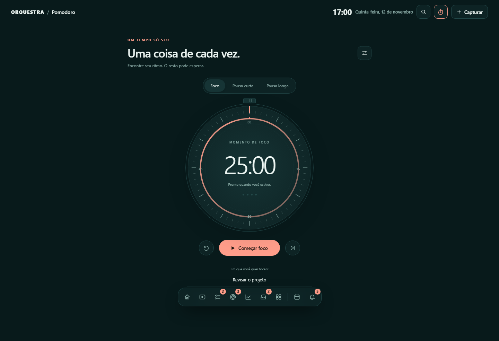
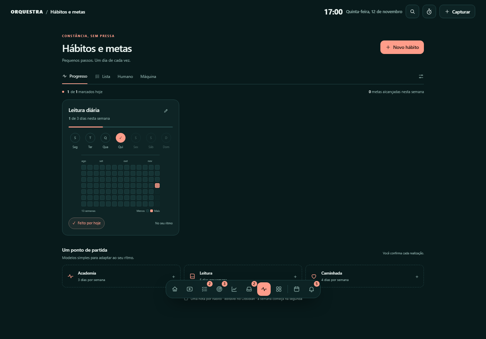

# Pomodoro e hábitos

## Pomodoro

O ícone de cronômetro ao lado da busca abre `/foco`. A home fica dedicada à visão
geral do vault. O mostrador combina marcações de relógio, anel de progresso,
marcador móvel, tempo restante e quatro indicadores de ciclo.

As etapas são Foco, Pausa curta e Pausa longa. Os padrões são 25, 5 e 15 minutos.
O botão de ajustes abre um modal com incrementos e campos numéricos (1–180 minutos),
além de aviso sonoro opcional. Não há select de duração.

Começar/Pausar preserva o restante. Reiniciar e trocar de etapa pedem confirmação
se há um ciclo rodando. Uma etapa concluída aguarda sua ação para começar a próxima;
quatro focos concluídos sugerem pausa longa. Pausas não contam como focos realizados.

O prazo é guardado no navegador, por vault e por aba. Navegar no Orquestra ou
recarregar a mesma aba preserva o timer. Fechar a aba encerra esse acompanhamento;
ele não é um serviço de notificação em segundo plano. Se o sistema suspender a aba,
o tempo é recalculado ao voltar, sem depender de contar cada segundo. Som depende
da permissão e do comportamento do navegador. Os ciclos não são notas de produtividade
nem sincronizam automaticamente entre dispositivos.

Sem timer em andamento não há ciclo de atualização contínua. A aba oculta pausa
as atualizações visuais; o prazo continua válido. Leitores de tela recebem mudanças
de etapa, não um anúncio a cada segundo.

## Hábitos e metas

É um módulo real em `habitos/`, com arquivo `_modulo.yaml`, itens, orientações
humanas e instruções de máquina. Adicione em Ajustes → Pastas, ou abra
`/m/habitos` e crie um hábito: a pasta é preparada no primeiro registro, sem
sobrescrever uma estrutura incompatível. O módulo aparece na home e no menu como
os demais. O endereço antigo `/habitos` redireciona para o módulo.

Progresso mostra a meta semanal, sete indicadores dos dias, mapa de treze semanas,
registro de hoje e resumo geral. Lista oferece uma versão compacta dos mesmos
hábitos. Não existe uma lista paralela fora do vault.

Novo hábito e Editar abrem o formulário com nome, meta de 1 a 7 dias por semana e
tags. Os modelos Academia, Leitura e Caminhada apenas preenchem o formulário: você
confirma a criação. Marcar hoje grava uma data ISO em `registros`; clicar novamente
desmarca o dia. O resumo e o mapa atualizam sem recarregar a página inteira.

As metas contam dias da semana civil iniciada na segunda-feira; datas futuras
não aumentam a realização desta semana. Registros inválidos não são descartados
silenciosamente: o painel avisa e exige correção no editor. Alterar nome ou meta
preserva as datas já realizadas e os outros metadados da nota. Toda gravação exige
a versão atual, para evitar sobrepor uma alteração feita por um agente ou Obsidian.

São hábitos de frequência semanal. Metas financeiras, subobjetivos e hábitos com
múltiplas ocorrências por dia continuam fora deste modelo simples.

## Interface

No celular: [Pomodoro](img/foco-390.png) e [Hábitos](img/habitos-390.png).
