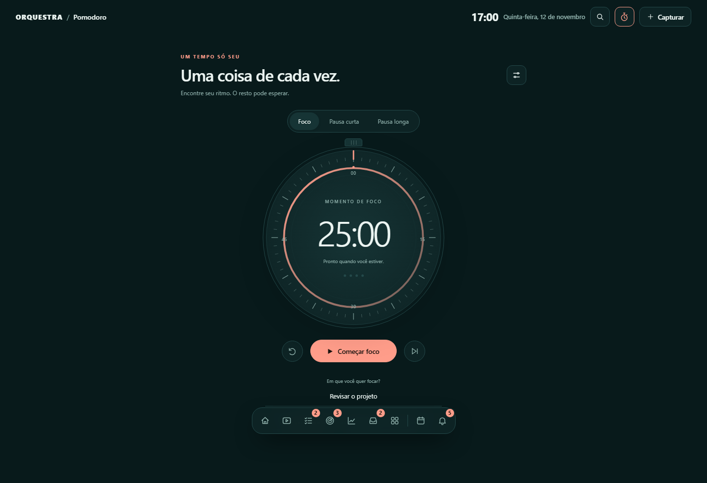
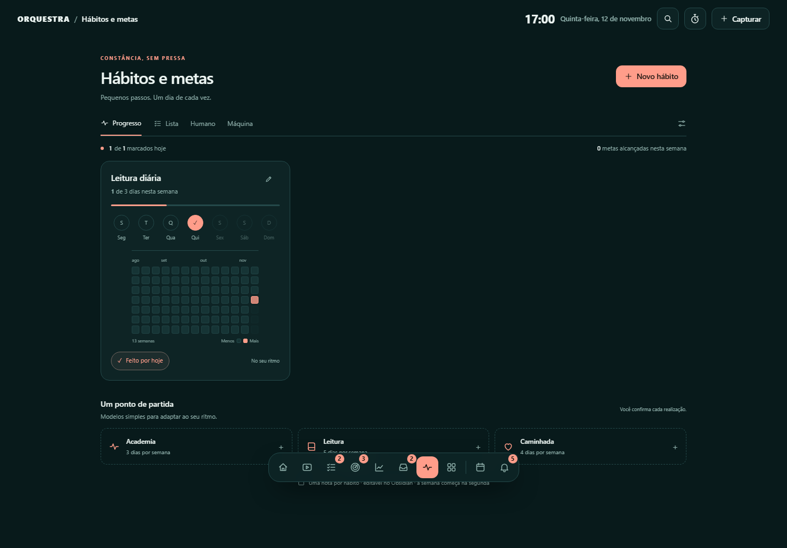

# Pomodoro e hábitos

## Notas de realizações

Notas em `habitos/execucoes/Nome do hábito/` aparecem dentro do hábito, separadas
dos itens de Hábitos e de Notas. Um link como `[[Nome do hábito]]` identifica a
relação; a pasta também pode dar contexto quando há um único hábito com esse nome.
A data vem de `data: AAAA-MM-DD` ou da data no nome do arquivo. Clique no nome
do hábito para ver a descrição e as notas, das mais recentes para as mais antigas,
seis por página. **Adicionar nota** guarda o texto na data de hoje. Para outro dia,
abra o quadrado daquela data no mapa e use **Adicionar nota**. **Todas as notas**
retira o filtro. Agentes podem guardar uma execução na data relatada com
`anotar_realizacao` no [MCP](mcp.md). A nota é independente da marcação no mapa.

## Pomodoro

O ícone de cronômetro ao lado da busca abre `/foco`. A home fica dedicada à visão
geral do vault. O mostrador combina marcações de relógio, anel de progresso,
marcador móvel, tempo restante e quatro indicadores de ciclo.

As etapas são Foco, Pausa curta e Pausa longa. Os padrões são 25, 5 e 15 minutos.
O botão de ajustes abre um modal com incrementos e campos numéricos (1–180 minutos),
além de aviso sonoro opcional. Não há select de duração.

Começar/Pausar preserva o restante. Reiniciar e trocar de etapa pedem confirmação
se há um ciclo rodando. Uma etapa concluída aguarda sua ação para começar a próxima;
quatro focos concluídos sugerem pausa longa. Pausas não contam como focos realizados.

O prazo é guardado no navegador, por vault e por aba. Navegar no Orquestra ou
recarregar a mesma aba preserva o timer. Fechar a aba encerra esse acompanhamento;
ele não é um serviço de notificação em segundo plano. Se o sistema suspender a aba,
o tempo é recalculado ao voltar, sem depender de contar cada segundo. Som depende
da permissão e do comportamento do navegador. Os ciclos não são notas de produtividade
nem sincronizam automaticamente entre dispositivos.

Sem timer em andamento não há ciclo de atualização contínua. A aba oculta pausa
as atualizações visuais; o prazo continua válido. Leitores de tela recebem mudanças
de etapa, não um anúncio a cada segundo.

## Hábitos e metas

É um módulo real em `habitos/`, com arquivo `_modulo.yaml`, itens, orientações
humanas e instruções de máquina. Adicione em Ajustes → Pastas, ou abra
`/m/habitos` e crie um hábito: a pasta é preparada no primeiro registro, sem
sobrescrever uma estrutura incompatível. O módulo aparece na home e no menu como
os demais. O endereço antigo `/habitos` redireciona para o módulo.

Progresso mostra a meta semanal, histórico de atividade,
registro de hoje e resumo geral. Lista oferece uma versão compacta dos mesmos
hábitos. No celular, Progresso organiza cards compactos em duas colunas, com um
botão grande de Marcar hoje na base de cada card; após marcar, ele mostra Feito
hoje e soma novas realizações a cada marcação. A Lista mantém título e descrição à esquerda e o
histórico de atividade à direita. Cards, indicadores e botões respeitam a
personalização de bordas. O dia atual fica contornado e os registros realizados
usam a cor de destaque do tema.

Use a alça no topo de cada hábito para arrastá-lo até outra posição, em Progresso
ou Lista. No teclado, foque a alça e use as setas para mover; **Esc** cancela um
arraste em andamento. A ordem fica salva no cofre e é mantida ao reabrir o painel,
mesmo após marcar uma realização. Isso não altera as notas nem os registros.
Para hábitos com realizações repetidas, a intensidade da cor acompanha a
contagem de cada dia. Quando todas as marcações são únicas, os tons variam
visualmente entre os dias.
Não existe uma lista paralela fora do vault.

Novo hábito e Editar abrem um formulário compacto com nome, descrição opcional,
meta de 1 a 7 dias por semana e tags. A descrição é o corpo da nota: aparece na
Lista ou ao abrir o hábito pelo nome; fica oculta nos cards de Progresso.
Os modelos Academia, Leitura e Caminhada apenas preenchem o formulário: você
confirma a criação. Marcar hoje grava uma data ISO em `registros`; clicar novamente
registra mais uma realização no mesmo dia. O resumo e o mapa atualizam sem recarregar a página inteira.

As metas contam dias da semana civil iniciada na segunda-feira; datas futuras
não aumentam a realização desta semana. Registros inválidos não são descartados
silenciosamente: o painel avisa e exige correção no editor. Alterar nome ou meta
preserva as datas já realizadas e os outros metadados da nota. Toda gravação exige
a versão atual, para evitar sobrepor uma alteração feita por um agente ou Obsidian.

As repetições no mesmo dia aumentam a contagem de realizações sem aumentar a meta
semanal de dias.

## Interface

No celular: [Pomodoro](img/foco-390.png) e [Hábitos](img/habitos-390.png).

No celular, Progresso mostra as dez semanas mais recentes, com título em uma
linha e marcadores maiores. O nome completo continua acessível ao abrir o hábito
ou editar. A Lista mostra oito semanas. No desktop, Progresso mostra treze.
Passe o mouse sobre um quadrado para consultar sua
data e realização. Pelo teclado, Tab entra no mapa no dia atual e as setas
percorrem os dias; Escape fecha a dica. No desktop e na Lista, o ícone + ao lado
de Editar marca hoje; quando marcado, mostra ✓ e passa a exibir a contagem a partir da segunda realização. Em Progresso
no celular, essa mesma ação ocupa o botão na base do card.
