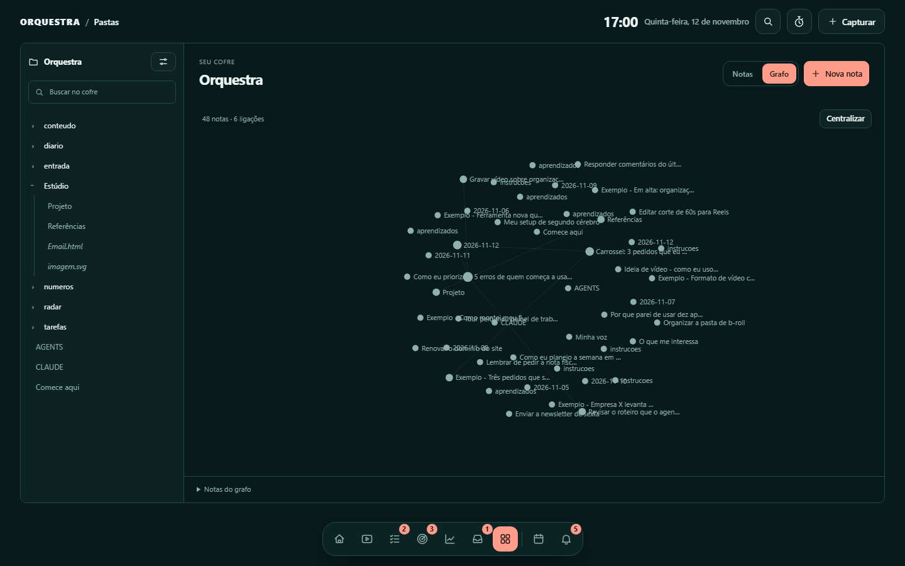

# Pastas e grafo

No celular, a árvore inicia recolhida e o grafo ocupa a área principal. O botão
de pasta expande a árvore; abrir uma nota recolhe a árvore e mostra o leitor na
área principal. Escape recolhe a árvore. A aba Lista oferece a navegação compacta.
O botão **Mostrar esta nota na pasta** destaca a nota no grafo completo e na árvore.
A URL preserva o caminho, inclusive acentos, com `nota=`.

## Visualizações de subpastas

A aba **Lista** exibe subpastas e notas em lista. Em **Ajustes → Visualizações**,
escolha **Cartões** ou **Pastas de vidro** para a aba visual. Cada pasta usa o
estilo da área até receber uma escolha própria. Projetos usa Pastas de vidro por
padrão e Estudos usa Cartões. No explorador, **Ajustes de Pastas** define o estilo
da aba visual ao lado de **Lista** e **Grafo**.
Subpastas, notas e mídias ficam acessíveis no mesmo nível, inclusive em pastas
vazias ou que contêm apenas anexos.

## Arquivar e excluir notas

**Arquivar** conserva a nota em `arquivo/` da sua área, para consulta futura.
**Excluir**, no cabeçalho da nota, move o arquivo para a lixeira após confirmação.
Depois da exclusão, o painel volta ao contexto de origem.
Anexos e notas relacionadas não são excluídos junto. Instruções de agentes,
configurações e arquivos de `maquina/` são protegidos contra exclusão pelo painel.

Use os botões em **Ajustes da pasta** para arquivar ou mover uma pasta para
a lixeira. A confirmação informa o que será movido. Uma pasta física pode ser
restaurada inteira, com suas subpastas e anexos. Em uma pasta de projeto ou estudo
organizada por vínculos, a ação move a nota principal e suas notas exclusivas.
Anexos e notas compartilhadas ficam no local original.

Abra **Pastas → Lixeira** para restaurar ou excluir definitivamente cada item.
A lista mostra uma linha por nota ou pasta, com os ícones Restaurar e Excluir definitivamente.
A seleção permite marcar vários itens e escolher uma ação no menu.
Restaurar processa cada nota sem sobrescrever caminhos ocupados; falhas ficam
selecionadas e aparecem no resultado. Excluir definitivamente em lote pede uma
confirmação com a quantidade antes de iniciar.
A restauração exige o caminho original livre e nunca substitui outra nota.
A limpeza definitiva pede outra confirmação e confere a versão do arquivo.
Não existe limpeza automática. As notas ficam em `.trash/orquestra/` do vault;
essa pasta não aparece na busca, nas listas ou na agenda.

Excluir definitivamente remove somente a cópia da lixeira. Backups e versões
locais anteriores de recuperação são independentes e não são apagados por essa
ação. A lixeira é um recurso do painel; não há ferramenta MCP de exclusão.

O explorador apresenta os arquivos do vault em uma árvore lateral persistente.
A primeira visualização é o grafo. Cada pasta lembra sua escolha explícita entre
Notas e Grafo neste navegador. No grafo, cada ponto representa uma
nota e cada linha representa uma referência interna resolvida dentro da pasta
atual, em formato `[[wikilink]]` ou link Markdown.

## Navegação

- Em **Grafo**, a seta expande ou recolhe um ramo. O nome abre a pasta e mantém
  o grafo disponível. Clicar em uma nota abre a leitura.
- Use **Notas** para ver a lista de subpastas, notas e anexos. Clicar numa pasta
  da lista ou no seu nome na árvore mostra o conteúdo mantendo o modo Notas;
  a seta da árvore apenas expande ou recolhe. Subir um nível e voltar ou avançar
  pelo navegador também mantêm a visualização atual.
- Clique em uma nota da árvore, da lista ou do grafo para ler sem fechar o explorador.
- A seta de voltar no leitor retorna à visualização escolhida. Nas pastas abertas pela lista, a seta ao lado do título sobe um nível.
- Arraste uma nota para reposicioná-la ou o fundo para mover a vista. Use a roda do mouse ou `+` e `-` para aproximar.
- **Centralizar** ajusta o conjunto de notas ao espaço disponível. O explorador ocupa a altura da janela; listas longas e documentos rolam dentro dos seus painéis.
- Notas sem ligações ficam próximas do conjunto conectado, sem reduzir o miolo do grafo a um ponto distante.
- O enquadramento acompanha a acomodação inicial e os ajustes das forças. Ao
  aproximar ou arrastar, a vista passa ao seu controle; **Centralizar** retoma o
  enquadramento. Os pontos conservam um tamanho legível mesmo ao afastar, e seu
  tamanho varia com a quantidade de conexões. Notas sem links usam a cor de destaque.
- Quando não há ligações no recorte, **Notas do grafo** explica como conectar notas.
  Compartilhar uma pasta não cria uma linha: ela representa uma referência real.
- Nas opções do grafo, busque pelo nome ou oculte notas sem ligações e rótulos.
- Em **Forças**, ajuste o grafo como no Obsidian: **centrípeta** puxa tudo para o
  centro, **repulsão** afasta as notas entre si, **força dos links** aperta as
  ligações e **distância dos links** define o comprimento delas. Os padrões são
  0,52 · 10 · 1 · 174; **Restaurar padrão** volta a eles. A escolha fica guardada
  neste navegador, por cofre. Centro e repulsão também atuam em notas sem links;
  força e distância dos links atuam nas conexões existentes. Arrastar uma nota
  puxa as vizinhas junto.
- Passe sobre uma nota para destacar suas conexões. Pelo teclado, use as setas para escolher uma nota, Enter para abrir e `0` para centralizar.
- Em uma pasta adotada no painel, as subpastas continuam navegáveis. O painel sugere Lista quando um quadro não teria uma distribuição útil de status e memoriza a visualização escolhida para cada área e cofre.

O grafo mostra as notas e ligações de todo o cofre, mesmo ao navegar por uma pasta.
**Mostrar esta nota na pasta**, no leitor, abre o grafo com a nota destacada e
seus antecessores expandidos na árvore. O conteúdo só abre ao selecionar a nota.
A resolução considera o contexto da nota e
caminhos explícitos. Quando ainda houver mais de um destino possível, informe
o caminho para tornar a ligação inequívoca.

## Verificação de links

O botão de corrente em Pastas abre **Links do cofre**, com o recorte atual.
O diagnóstico usa o mesmo resolvedor do leitor e do grafo e separa referências
ambíguas, anexos ausentes e títulos/blocos ausentes de notas ainda não criadas.
Os arquivos permanecem intactos; URLs externas não são consultadas.

Cada ocorrência informa a nota de origem e a linha do corpo Markdown. A verificação
inclui referências para fora da pasta selecionada, desde que dentro do cofre,
mesmo que essas ligações não apareçam no recorte visual do grafo.
Veja [formatos e limites](vinculos.md).

## Imagens e vídeos

Imagens podem ser inseridas como `![[foto.png]]` ou `![[foto.png|300]]`.
No Markdown padrão, use `![Descrição]` seguido do caminho entre parênteses;
caminhos com espaços ficam entre `<` e `>`. Caminhos relativos à nota têm
prioridade, seguidos pelo caminho no vault e pela busca pelo nome do arquivo.
PNG, JPEG, WebP, GIF, SVG, AVIF, BMP e ICO são reconhecidos. A exibição depende
também do suporte do navegador. MP4 e WebM podem ser abertos pelo explorador.

## Templates HTML

Arquivos `.html` e `.htm` aparecem na árvore e na lista de anexos. O painel abre
uma prévia isolada que preserva HTML e CSS inline, incluindo tabelas de email.
Imagens locais e HTTPS são suportadas. Imagens HTTPS são buscadas no servidor de origem.
Scripts, formulários, navegação de topo e folhas de estilo externas ficam bloqueados.
Não é necessário converter o template em Markdown. Uma prévia no navegador não
substitui testar a mensagem nos clientes de email usados pelos destinatários.

A edição de HTML é feita no editor de sua preferência; a edição de notas Markdown
continua disponível no leitor do painel.

## Editar uma nota

O botão **Voltar** junto às ações da nota retorna à tela anterior do painel.
Na leitura interna de Pastas, volta ao grafo ou à lista sem perder a árvore.
Uma nota aberta diretamente, sem histórico interno, retorna à sua área ou pasta.

Dê dois cliques no texto (ou aperte Enter com a nota selecionada). A nota fica
editável ali mesmo, com a mesma aparência: tabelas continuam tabelas e listas
continuam listas, e você passa de um parágrafo a outro clicando, sem trocar de modo.

- **Formatação:** Ctrl+B e Ctrl+I (Cmd no Mac) aplicam negrito e itálico. Você também
  pode digitar Markdown, como `**negrito**`, `[[Outra nota]]` ou `- item`, que vira
  formatação ao salvar.
- **Salvar:** Escape, Ctrl+S ou clicar fora da nota. Cancelar volta à última versão salva.
- **Links:** durante a edição, um clique num link só posiciona o cursor. Ctrl+clique
  salva e abre o link.
- **Só o que mudou:** ao salvar, apenas os blocos que você alterou são reescritos no
  arquivo. O resto continua exatamente como estava, inclusive a formatação do seu Markdown.

Quando o painel não consegue relacionar o texto exibido com as linhas do arquivo
(um rascunho recuperado, por exemplo), a edição abre o Markdown da nota inteira
numa caixa de texto. **Selecionar texto** no menu da nota faz o mesmo.

[Ver o explorador no celular](img/pastas-mobile.png).
