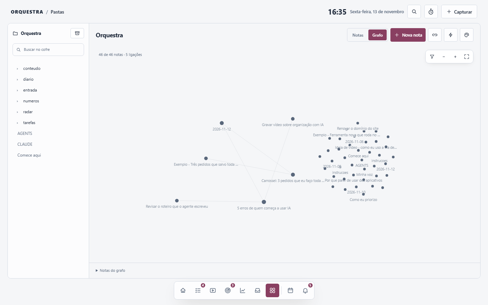

# Pastas e grafo

O explorador apresenta os arquivos do vault em uma árvore lateral persistente.
A primeira visualização é o grafo. Cada pasta lembra sua escolha explícita entre
Notas e Grafo neste navegador. No grafo, cada ponto representa uma
nota e cada linha representa uma referência interna resolvida dentro da pasta
atual, em formato `[[wikilink]]` ou link Markdown.

## Navegação

- Expanda ou recolha pastas pela seta ou pelo nome. A árvore mantém o grafo, o enquadramento e a pasta atual; clicar em uma nota abre a leitura.
- Use **Notas** para ver a lista de subpastas, notas e anexos.
- Clique em uma nota da árvore, da lista ou do grafo para ler sem fechar o explorador.
- A seta de voltar no leitor retorna à visualização escolhida. Nas pastas abertas pela lista, a seta ao lado do título sobe um nível.
- Arraste uma nota para reposicioná-la ou o fundo para mover a vista. Use a roda do mouse ou `+` e `-` para aproximar.
- **Centralizar** ajusta o conjunto de notas ao espaço disponível. O explorador ocupa a altura da janela; listas longas e documentos rolam dentro dos seus painéis.
- Notas sem ligações ficam próximas do conjunto conectado, sem reduzir o miolo do grafo a um ponto distante.
- Nas opções do grafo, busque pelo nome ou oculte notas sem ligações e rótulos.
- Passe sobre uma nota para destacar suas conexões. Pelo teclado, use as setas para escolher uma nota, Enter para abrir e `0` para centralizar.
- Em uma pasta adotada no painel, as subpastas continuam navegáveis. O painel sugere Lista quando um quadro não teria uma distribuição útil de status e memoriza a visualização escolhida para cada área e cofre.

O grafo mostra até 600 notas e 3.000 ligações por consulta. O indicador informa
quando a visualização é parcial. A resolução considera o contexto da nota e
caminhos explícitos. Quando ainda houver mais de um destino possível, informe
o caminho para tornar a ligação inequívoca.

## Verificação de links

O botão de corrente em Pastas abre **Links do cofre**, com o recorte atual.
O diagnóstico usa o mesmo resolvedor do leitor e do grafo e separa referências
ambíguas, anexos ausentes e títulos/blocos ausentes de notas ainda não criadas.
Os arquivos permanecem intactos; URLs externas não são consultadas.

Cada ocorrência informa a nota de origem e a linha do corpo Markdown. A verificação
inclui referências para fora da pasta selecionada, desde que dentro do cofre,
mesmo que essas ligações não apareçam no recorte visual do grafo.
Veja [formatos e limites](vinculos.md).

## Imagens e vídeos

Imagens podem ser inseridas como `![[foto.png]]` ou `![[foto.png|300]]`.
No Markdown padrão, use `![Descrição]` seguido do caminho entre parênteses;
caminhos com espaços ficam entre `<` e `>`. Caminhos relativos à nota têm
prioridade, seguidos pelo caminho no vault e pela busca pelo nome do arquivo.
PNG, JPEG, WebP, GIF, SVG, AVIF, BMP e ICO são reconhecidos. A exibição depende
também do suporte do navegador. MP4 e WebM podem ser abertos pelo explorador.

## Templates HTML

Arquivos `.html` e `.htm` aparecem na árvore e na lista de anexos. O painel abre
uma prévia isolada que preserva HTML e CSS inline, incluindo tabelas de email.
Imagens locais e HTTPS são suportadas. Imagens HTTPS são buscadas no servidor de origem.
Scripts, formulários, navegação de topo e folhas de estilo externas ficam bloqueados.
Não é necessário converter o template em Markdown. Uma prévia no navegador não
substitui testar a mensagem nos clientes de email usados pelos destinatários.

A edição de HTML é feita no editor de sua preferência; a edição de notas Markdown
continua disponível no leitor do painel.

[Ver o explorador no celular](img/pastas-mobile.png).
