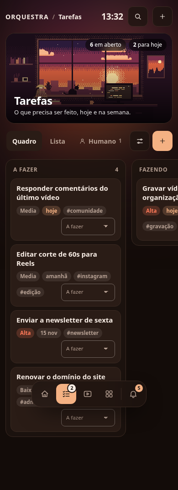

# Revisão de lançamento — 12 de novembro de 2026

Revisão da versão 0.4 sobre `285a87b6ba0c55039b7fd76362dd23f0938e6822`.
O produto permanece um aplicativo pessoal local, com acesso remoto pela rede
privada. Distribuir o código à comunidade é diferente de hospedar o vault de
alguém em uma porta pública: o painel não possui autenticação para esse modelo.

## Achados e correções

| Área | Achado | Resultado |
| --- | --- | --- |
| Mobile | Dock de cinco áreas mais controles do sistema escondia destinos em 320/390 px | Dois atalhos, preservando a área atual; gaveta com todos os destinos, inclusive Ajustes |
| Abas | “Novo” e Personalizar ficavam depois das abas, fora da parte visível | Ações permanecem visíveis; apenas as visões rolam horizontalmente |
| Conexão | Eventos perdidos durante uma queda não eram recuperados | Indicador discreto de reconexão e revisão da página ao reconectar, inclusive após falha inicial e retorno pelo cache do navegador |
| Atualização | Cada evento disparava nova consulta de resumo | Debounce de 180 ms e, no máximo, um pedido em curso; rajadas acumuladas geram uma consulta posterior |
| Personalizar | Sair do campo permitia recarga automática e uma aba antiga podia regravar escolhas anteriores | Alterações pendentes protegem a tela mesmo sem foco; a versão lida do YAML acompanha o formulário, e mudanças externas retornam 409 sem gravar |
| Kanban | Movimentar um cartão fazia a contagem usar apenas os cartões visíveis | Totais independentes do limite de 80 cartões; seletor e arraste ficam bloqueados durante a gravação do cartão |
| Animações | RAF continuava acordando em modo reduzido ou página oculta; todas as capas eram preparadas de uma vez | Preparação por visibilidade e agendamento na cadência de 12 quadros/s somente quando há cena animável; preferência pode mudar sem recarregar |
| Servidor | Contagens ordenavam notas sem necessidade e a prévia salva de Markdown usava o laço ASGI | Contagens sem ordenação; edição e renderização trabalham em thread com uma visão coerente do índice |
| Segurança | CSP permitia JavaScript inline sem ser necessário | `script-src 'self'`; estilos de aparência continuam permitidos |

A API de personalização aceita `versao` opcional para clientes existentes. O
painel sempre envia a versão; clientes próprios devem encaminhar a versão da
configuração que leram para receber a mesma proteção contra formulários antigos.
Não há migração dos arquivos do usuário nem dependência nova de runtime.

## Desempenho medido

Linux, Python 3.12.14, 10.000 notas de 1.036 bytes no módulo Tarefas. Um aquecimento
e sete amostras por rota, via TestClient, sem navegador, watcher ou agendamentos.
As duas execuções usam o mesmo script e as mesmas notas. A coluna anterior mede
o índice antes da remoção das ordenações; o restante da revisão visual já estava
na árvore de trabalho. Os JSONs podem ser reproduzidos com o comando abaixo.

| Operação | Mediana anterior | Mediana corrigida |
| --- | ---: | ---: |
| Início | 111,12 ms | 58,08 ms |
| Lista de tarefas | 117,07 ms | 86,11 ms |
| Quadro | 121,34 ms | 95,67 ms |
| Resumo ao vivo | 63,46 ms | 32,98 ms |
| Busca | 85,33 ms | 70,59 ms |

A carga inicial foi de 5,23 s para 4,97 s; essa variação isolada não demonstra
ganho de inicialização. O HTML permaneceu com o mesmo tamanho nas duas medições:
47.926 bytes na lista e 72.467 no quadro. Não foram medidos memória, disco de rede,
Safari/iOS, sincronizadores ou notas com anexos grandes. Os resultados não são um SLA.

```bash
uv run --frozen python scripts/medir_desempenho.py --notas 10000 --amostras 7
```

## Jornada e aparência

O roteiro de navegador cria um vault do zero, a partir do perfil Criador, e
verifica quinze rotas em 1440, 390 e 320 px. Usa arquivos fictícios e configuração
temporária. Verifica criação/edição, recuperação local, conflito externo e cópia,
personalização pendente, números, decisão, captura com falha e repetição, totais
do Kanban e parada/retomada de animações. A gaveta é exercitada com teclado.



O grupo opcional `browser` contém Playwright. Usuários do painel não precisam
instalá-lo. O job Chromium da CI executa o mesmo roteiro descrito em
[Contribuir](../CONTRIBUTING.md), sem coletores, backups ou credenciais reais.
Testes Node cobrem reconexão, isolamento entre vaults, consultas sobrepostas e
retorno pelo cache do navegador; teste ASGI cobre pedidos concorrentes durante
a renderização de uma nota.

## Critérios para disponibilizar à comunidade

- Confirmar os checks do commit exato, incluindo o novo job Chromium, empacotamento e scanner de segredos.
- Conferir instalação de wheel, sdist e checkout editável com `scripts/verificar_pacote.py`.
- Validar Tailscale Serve e Obsidian reais nos sistemas divulgados como suportados; não inferir isso de testes de API ou largura emulada.
- Revisar a versão e preparar a tag/release com as instruções de atualização. O repositório continua privado até a etapa de publicação escolhida pelo mantenedor.
- Repetir auditoria de dependências e histórico antes de tornar o código público. A auditoria local desta revisão não encontrou vulnerabilidades conhecidas nas dependências consultadas.

Os limites de conservação de arquivos e execução de scripts continuam descritos
em [Segurança](../SECURITY.md) e [Backup](backup.md). Não foram usados vaults,
tokens, remotos de backup ou integrações reais do usuário.
