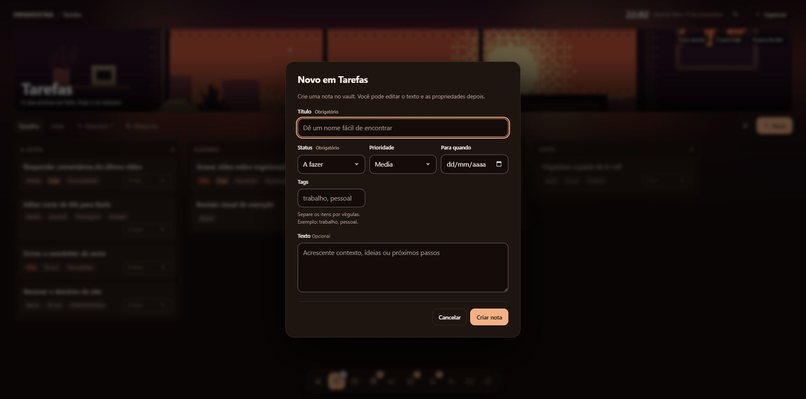
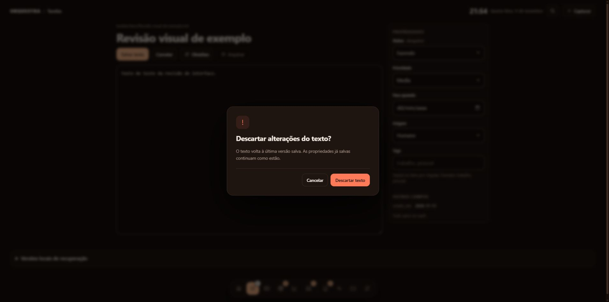
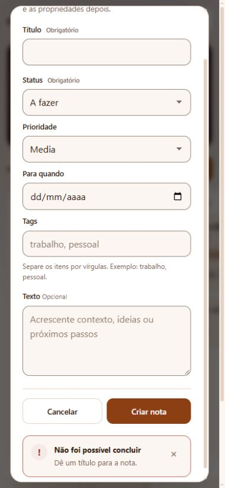

# Revisão de UI e UX — 11 de novembro de 2026

Revisão implementada sobre a preparação de produção da versão 0.4.0. Mantém os temas locais, os controles nativos do navegador e o funcionamento sem dependências visuais externas.

## Correções priorizadas

| Prioridade | Problema encontrado | Comportamento implementado |
| --- | --- | --- |
| Crítico para a experiência | A nota podia mostrar “Tudo salvo” depois de começar outro texto | O estado muda imediatamente entre rascunho, salvando, salvo e falha. Uma gravação pendente ou falha continua tendo precedência; o leitor de tela não recebe o mesmo anúncio a cada tecla. |
| Importante | Falha ao salvar preferências podia recarregar a página e apagar a mensagem | Recarrega somente após sucesso. Mantém valores editados, reabilita controles e explica a falha. Nome vazio tem instrução junto ao campo. |
| Importante | HTTP 200 com resposta ilegível podia anunciar sucesso | Respostas inválidas falham explicitamente e mantêm o formulário para nova tentativa. |
| Importante | Avisos desapareciam antes de poderem ser lidos ou acionados | Erros, alertas e avisos com ação permanecem até fechar. Sucessos duram seis segundos; o prazo pausa durante foco ou passagem do ponteiro. Repetições iguais são agrupadas. |
| Importante | Avisos fora de um modal ficam inacessíveis enquanto ele está aberto | O aviso entra no próprio modal e a falha é trazida à área visível, sem roubar foco. Fechar pelo teclado devolve o foco ao acionador quando disponível. |
| Importante | Confirmações nativas eram inconsistentes com a interface | Diálogos HTML identificam a ação e a consequência, focam Cancelar, respeitam Escape e restauram o foco. Ações de descarte são visualmente distintas. Autorizações continuam exigindo os mesmos dados e permissões. |
| Importante | Ajuda só em placeholder, nomes acessíveis repetidos e IDs de campos colidentes | Rótulos e descrições têm referências próprias; ajudas permanecem após digitar. Campos com espaço, hífen, percentual e Unicode recebem IDs distintos. Booleanos obrigatórios continuam aceitando `false`. |
| Importante | Seleções visuais não ofereciam navegação completa pelo teclado | Grupos de aparência têm um ponto de entrada no Tab e aceitam setas, Home e End. Botões de tema informam seleção. |
| Importante | Onboarding podia usar análise ou seletor de pasta atrasado | Descarta respostas obsoletas, informa progresso e erros por campo, conserva escolhas na falha e impede submissão duplicada. A pasta escolhida é mostrada antes de preparar o vault. |
| Desejável | Aparência e densidade dos controles inconsistentes | Inputs e selects compartilham altura, espaçamento, borda, foco, estados de leitura, erro e desativação. Selects mantêm interação nativa, com acabamento da seta integrado ao tema. |
| Desejável | Ajustes longos e estados vazios pouco orientativos | Navegação local por seções, busca com botão visível e sugestões quando faltam termos ou resultados. Ajudas explicam a preservação dos valores nas notas. |
| Desejável | Controles apertados em telas menores | Formulários reorganizados, texto de entrada de 16 px em telas pequenas, ações maiores e botões dos ajustes alinhados. Movimento reduzido e cores forçadas têm estilos próprios. |

## Design e contraste

A paleta de apresentação ajusta textos, links e cores de estado nas superfícies e etiquetas. Os arquivos de tema e preferências do vault continuam preservados. Os testes cobrem 72 combinações dos três temas incluídos, modos claro/escuro e sugestões de cor, incluindo branco, preto e vermelho: contraste de pelo menos 4,5:1 para os textos verificados e 3:1 para a borda do campo sobre seu fundo.

Isso valida os pares de cores testados; não representa certificação de conformidade de todas as telas, imagens ou temas personalizados.

## Verificação executada

- Windows, Python 3.12.14: **301 testes Python aprovados e 1 ignorado** em 216,38 segundos. O caso ignorado depende de symlink de arquivo; os testes de junctions do Windows continuam incluídos.
- **29 testes JavaScript aprovados**, incluindo execução do `app.js` real com DOM simulado para falhas de configuração e estados da nota; ciclo de confirmação/foco, avisos e onboarding.
- Ruff aprovado; sintaxe dos scripts e `git diff --check` conferidos.
- Wheel e sdist construídos e instalados em ambientes novos. O smoke de instalação agora exige também `interface.js`, CSS e scripts de onboarding, evitando um pacote com interface incompleta.
- CI passa a executar todos os arquivos `tests/js/*.test.cjs`.
- Chrome real com vault descartável: criação de nota, alteração de propriedade, gravação e renderização do texto; cancelamento de descarte com Escape; mudança de aparência por seta do teclado; nome vazio nos Ajustes; atualização imediata do estado de rascunho; erro de envio visível dentro de modal longo; onboarding e formulários em larguras de 320 e 390 px, além do desktop. As capturas usam somente exemplos.

Não foram usados vaults ou notas reais. Não houve publicação externa nem execução de coletores. CI remota, Safari/Firefox, telas físicas de celular, leitores de tela e execução nativa no macOS/Linux continuam sem validação nesta rodada. Os estilos para cores forçadas e movimento reduzido foram implementados, mas não substituem testes assistivos reais.

## Referências de acessibilidade

Rótulos, instruções e mensagens foram orientados pelo [tutorial de formulários da W3C WAI](https://www.w3.org/WAI/tutorials/forms/) e pelas [orientações de notificações ao usuário](https://www.w3.org/WAI/tutorials/forms/notifications/). O contraste e o dimensionamento consideram os critérios pertinentes das [WCAG 2.2](https://www.w3.org/TR/WCAG22/), com os limites de validação descritos acima.
