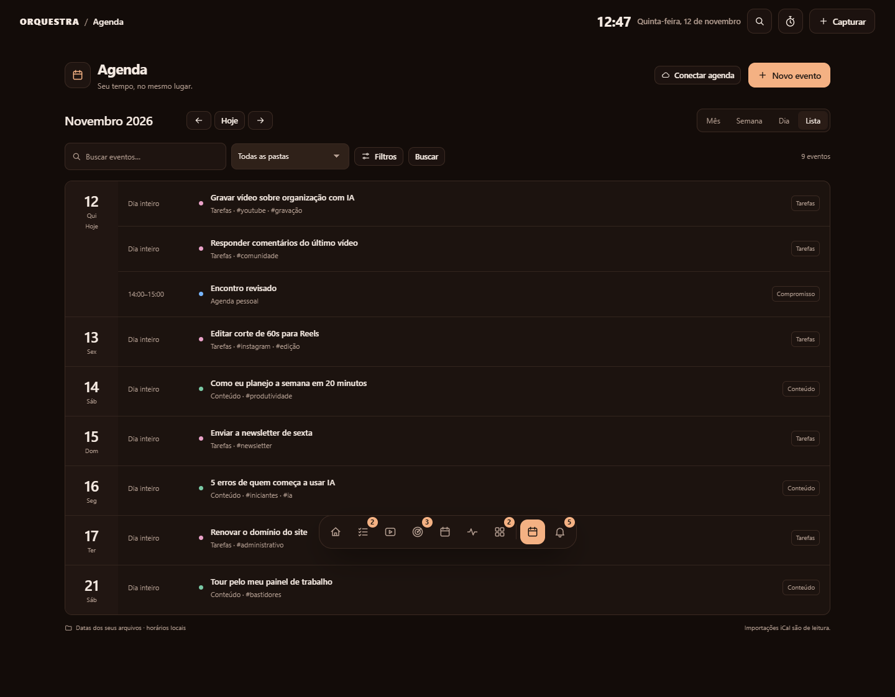
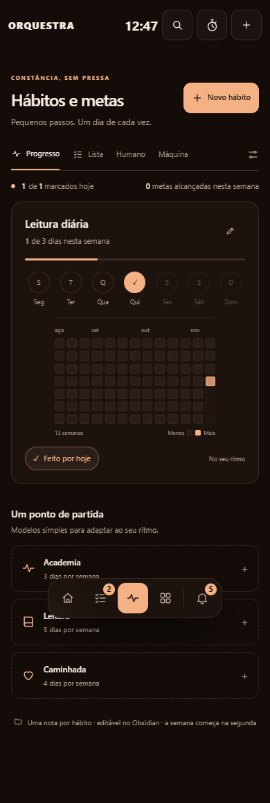
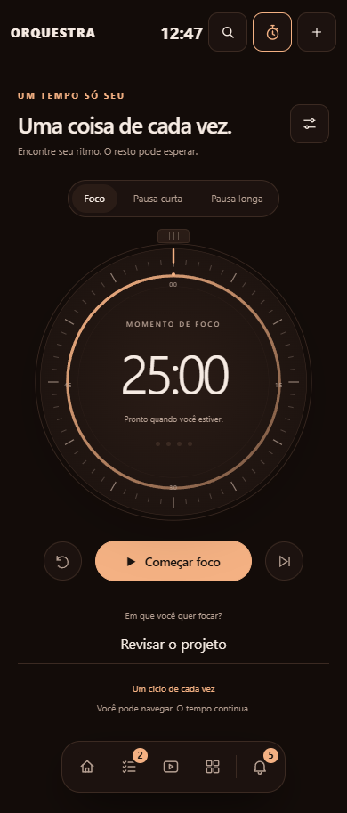
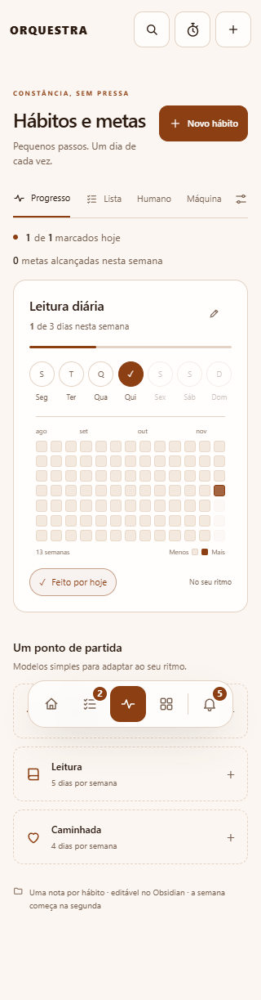

# Sincronização e revisão da comunidade — 12/11/2026

O candidato integra a revisão de `main` (`f62fd97`, PR #1) às funcionalidades que
estavam na árvore local. O trabalho foi preservado na branch
`codex/revisao-comunidade`, disponível no [PR #2](https://github.com/aglabsrv-sys/orquestra/pull/2).
O repositório permanece privado; não houve merge deste candidato, mudança de
visibilidade, criação de tag ou publicação em um registro de pacotes.

## Escopo e correções

- Agenda, Hábitos e Pomodoro integrados à navegação e ao armazenamento Markdown.
- Configuração local de variáveis, GitHub privado, iCal, Tailscale e início automático
  preservada, com as exigências de capacidade local e os limites de cada integração.
- Resumos SSE mantêm agrupamento e uma requisição por vez, validação do vault e
  seletores que aceitam nomes de pastas com aspas. Eventos comuns oferecem Atualizar;
  reconexões podem recarregar se não houver edição, arrasto ou diálogo aberto.
- Cenas continuam preparadas sob demanda e na cadência reduzida da versão remota;
  vídeos também atualizam o fundo e pausam com a aba oculta/movimento reduzido.
- Corrigida a habilitação das transições nativas entre documentos: agora dependem
  de `prefers-reduced-motion: no-preference`, em vez de apenas remover a animação.
  O roteiro detectou a rejeição nativa durante navegações com movimento reduzido.
- Preservados os dois relatórios locais/remotos que usavam o mesmo nome. A revisão
  anterior de Linux continua em [lançamento](revisao-lancamento-2026-11-12.md);
  a revisão local foi preservada em [integrações](revisao-integracoes-2026-11-12.md).
- Roteiro de navegador atualizado para os passos reais do onboarding, consulta de
  versões por botão e recarga explícita. Testes de mudanças externas esperam a
  conexão SSE abrir antes de alterar o arquivo, evitando perder o evento no setup.
- Changelog e índice dos guias incorporam as funcionalidades novas.

### Estabilidade do teste remoto de remoção

A CI de `6c2e1ec` identificou outra condição de corrida no setup: no Linux a nota
criada/editada pela API podia ser removida antes do primeiro snapshot do monitor
por polling. A conexão SSE aberta, sozinha, não confirma esse snapshot. O roteiro
agora cria e remove um marcador Markdown na raiz do vault descartável e aguarda os
eventos exatos de criação e remoção antes de executar as alterações externas.
Esse marcador não pertence ao módulo Tarefas e não dispara seu aviso Atualizar.
O teste continua exigindo o aviso e a atualização real da lista após a remoção.

## Verificações desta rodada

As verificações usam dados sintéticos, vaults descartáveis e `ORQUESTRA_HOME`
isolado. Nenhuma conta externa foi conectada pelo painel e nenhum vault pessoal
foi enviado ou modificado.

| Verificação | Resultado |
|---|---|
| Ruff, links locais e JavaScript | Passaram; 55 testes JavaScript |
| Python integrado | 409 passaram, 1 caso específico de Unix ignorado no Windows; repetição integral em clone limpo, em 440,99 segundos |
| Wheel, sdist e checkout Unicode | Passaram em clone de `1914468`; CLI e MCP stdio leem/gravam em vault descartável, incluindo Agenda e Hábitos |
| Dependências do lock | `pip-audit`: nenhuma vulnerabilidade conhecida na consulta desta rodada |
| Segredos | Gitleaks 8.30.1: histórico alcançável e arquivos candidatos sem achados |
| Interface | Passaram 15 jornadas e 29 rotas em 1440, 390 e 320 px no Chrome e no Chromium de um clone limpo, controlados por Playwright; sem erros JavaScript. Inclui todas as seções de Ajustes, modo claro e fonte de 18 px |
| CI remota | No código `d6f1c3c`, passaram navegador, segredos, dependências, os dois SDKs MCP e Ubuntu/Python 3.11. Windows e Ubuntu/Python 3.13 ainda executavam; macOS estava na fila. A publicação dos documentos dispara uma nova rodada, que deve ser conferida no head final |

O clone começou em `1914468` e recebeu `d6f1c3c`, que altera apenas o roteiro de
navegador. O código do aplicativo e os testes Python eram idênticos nos dois
commits. A atualização seguinte acrescenta documentação e capturas, sem alterar
esses fontes. Status remoto ao vivo no [PR](https://github.com/aglabsrv-sys/orquestra/pull/2)
e [execução do código revisado](https://github.com/aglabsrv-sys/orquestra/actions/runs/43251852149).

O binário local do Gitleaks veio da release oficial e teve SHA-256 conferido.
A varredura dos arquivos usa uma exportação do índice Git, excluindo ambientes,
caches e saídas locais. O mapa estrutural Graphify foi gerado para apoiar a leitura
dos módulos; não substitui os testes nem uma auditoria de segurança independente.

O smoke de instalação pode deixar temporários ocupados no Windows e informa o
caminho para limpeza posterior. Esse aviso não foi tratado como falha dos fluxos
de instalação, nem motivou a remoção de arquivos de outros processos.

## Medição local

Windows, Python 3.12.14, 1.000 notas sintéticas de 1.036 bytes, três amostras após
aquecimento: carga de 2.033 ms; medianas de 13,49 ms na home, 17,54 ms na lista,
18,95 ms no quadro, 5,52 ms no resumo e 16,96 ms na busca. São tempos do servidor
via TestClient, sem navegador/rede; não representam um vault real ou um SLA.

## Capturas finais

Geradas em 12/11/2026 pelo roteiro, com vault de demonstração descartável. As
imagens de início, tarefas e conteúdo do README também foram atualizadas.

| Hábitos, 390 px | Pomodoro, 390 px | Claro e fonte ampliada, 320 px |
|---|---|---|
|  |  |  |

## Publicação e limites

Antes de anunciar um release, conferir os checks do head atual do PR, fazer a
revisão final e escolher versão/tag e etapa de publicação. A licença MIT já está
presente. Disponibilizar o código não significa expor o painel ou o vault na internet.

Continuam pendentes de ambiente real: Tailscale Serve, Obsidian por plataforma,
login/envio de backup com conta GitHub de teste, calendários dos provedores e
início automático após login no sistema. Emulação de largura não valida aparelhos
físicos, Safari/iOS ou Android. iCal permanece importação de leitura, sem sincronização
bidirecional nem suporte completo a recorrências/alterações/exclusões.

Referências de implementação: [orientação oficial do Chrome sobre transições](https://developer.chrome.com/docs/modern-web-guidance/guides/ui-behaviors/cross-document-transitions).
