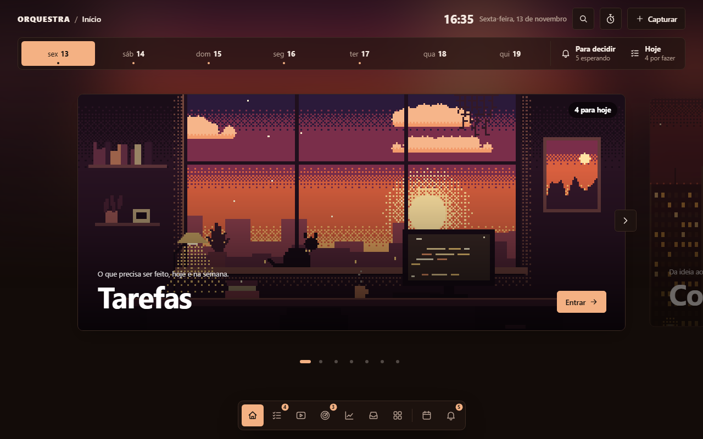
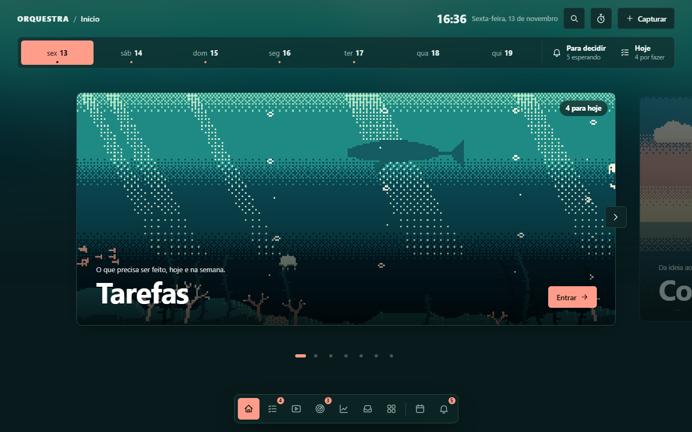
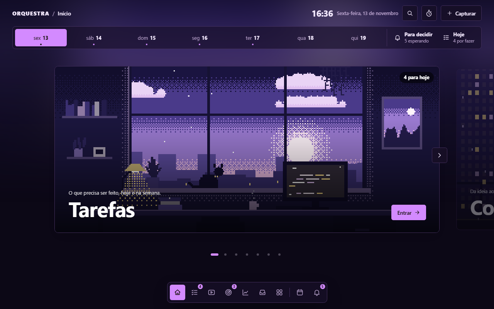
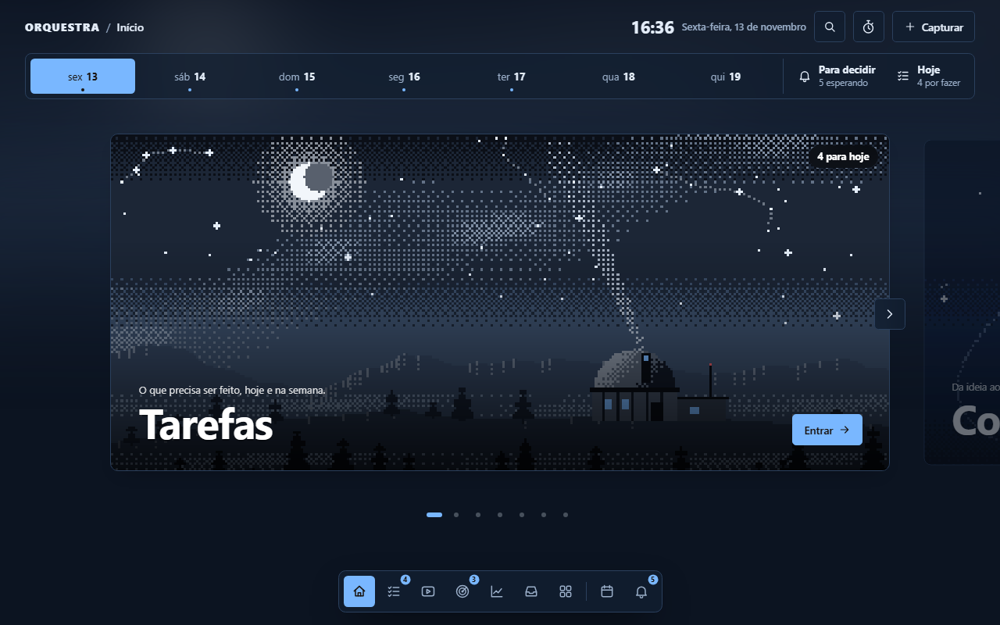
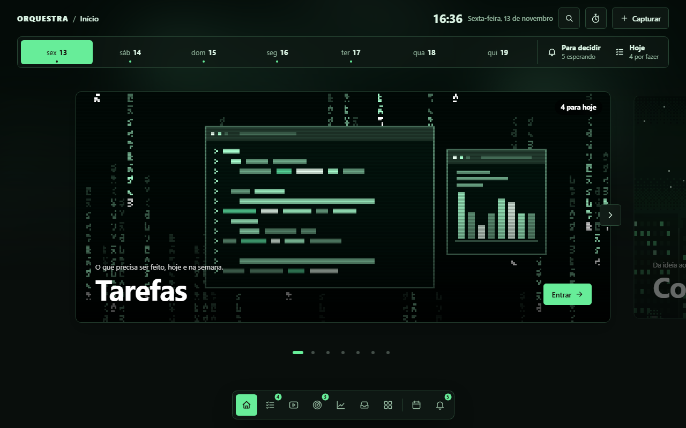
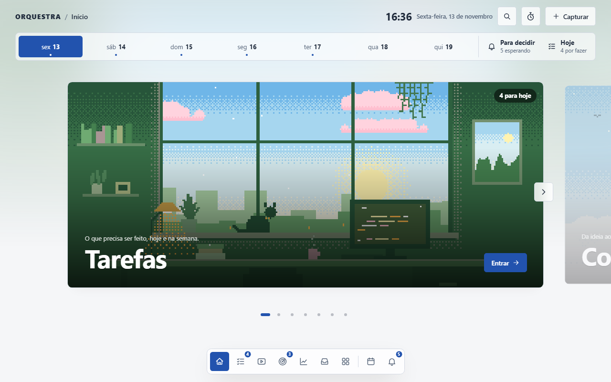
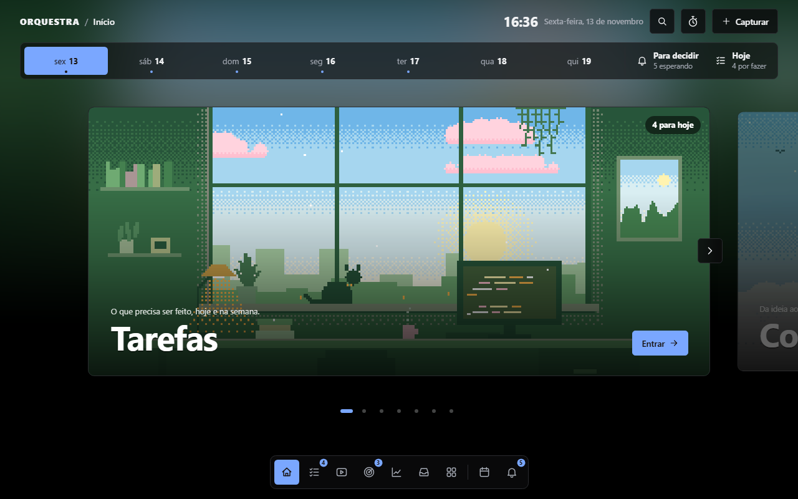
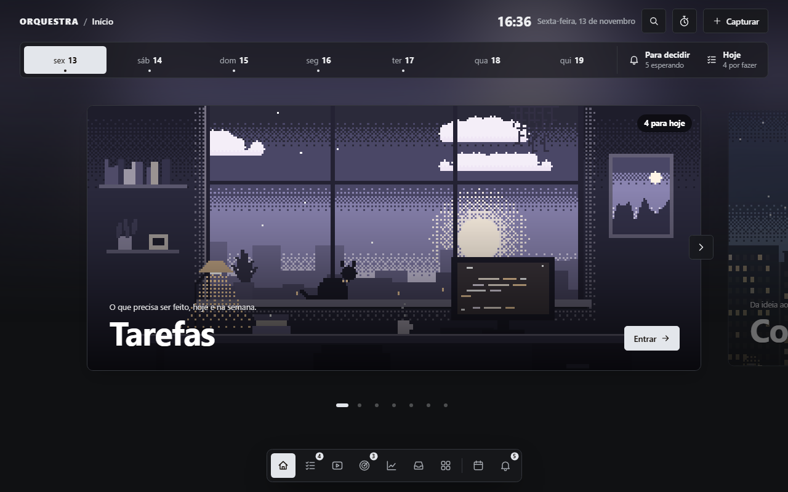
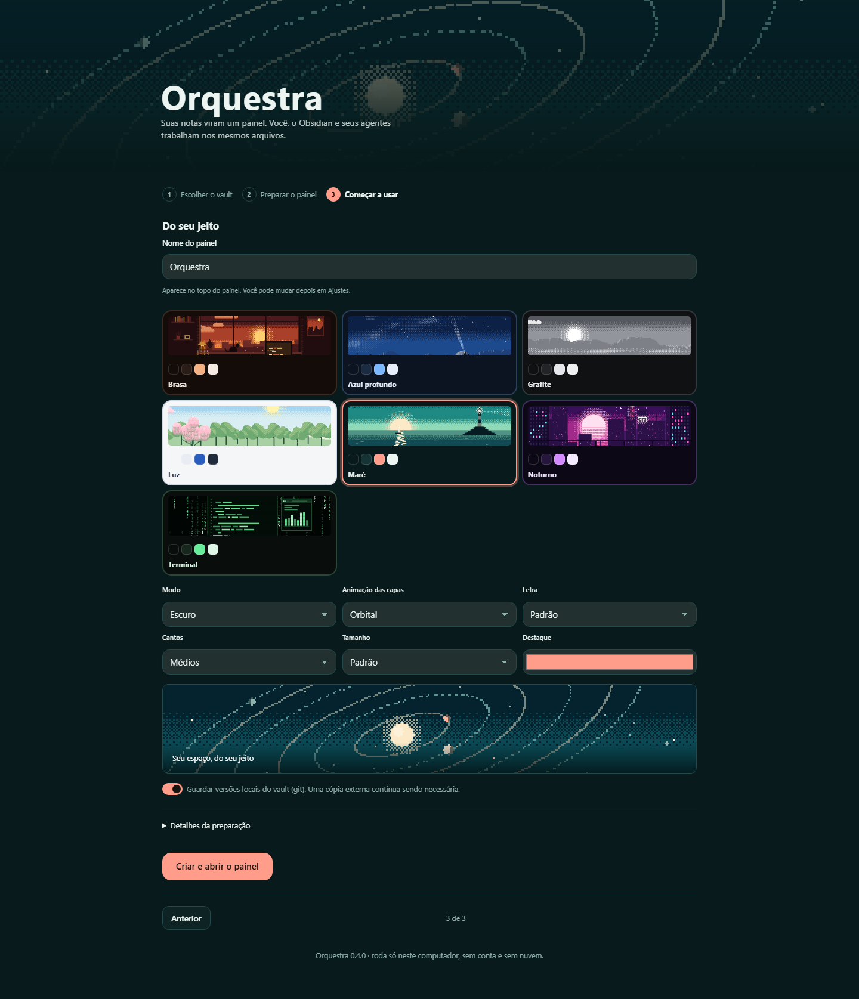
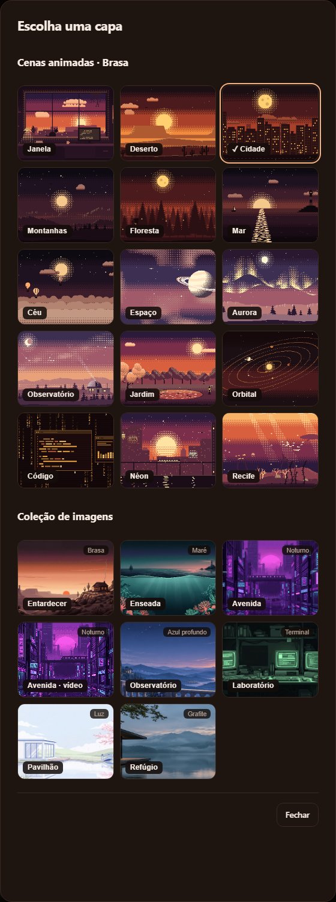

# Temas e capas

A aparência combina temas distribuídos com o app e preferências do vault:

- o **tema** define cores e capas; versões próprias podem ser guardadas em `_orquestra/temas/`;
- as **suas escolhas** por cima dele (`aparencia:` no `orquestra.yaml`): claro ou
  escuro, cor de destaque, cantos, letra e tamanho da fonte.

Tudo se muda em **Ajustes**, sem editar arquivo. Como está no vault, um agente
também consegue: "crie um tema verde-escuro com capas de floresta".

## Do seu jeito (Ajustes > Aparência)

| Escolha | Opções | No `orquestra.yaml` |
|---|---|---|
| Claro ou escuro | Escuro, Claro, Igual ao sistema | `modo: escuro \| claro \| auto` |
| Cor de destaque | a do tema, oito sugestões ou qualquer cor | `destaque: "#7cc4ff"` (vazio usa a do tema) |
| Cantos | Retos, Discretos, Médios, Redondos (botões em pílula) | `cantos: reto \| discreto \| medio \| redondo` |
| Letra | Padrão, Serifada, Arredondada, Monoespaçada | `fonte: sistema \| serifada \| arredondada \| mono` |
| Tamanho da fonte | Pequena, Padrão, Grande | `tamanho: pequena \| padrao \| grande` |

```yaml
aparencia:
  modo: auto
  destaque: "#7cc4ff"
  cantos: redondo
  fonte: sistema
  tamanho: padrao
```

Três detalhes de como isso funciona:

- **A cor de destaque se ajusta ao modo.** Um tom pastel aparece bem no escuro e
  some no claro. Em vez de recusar a sua cor, o painel escurece (ou clareia) só o
  necessário para ela continuar legível, mantendo o mesmo tom, e escolhe sozinho se
  o texto em cima dela fica preto ou branco. As amostras em Ajustes já mostram a cor
  ajustada para o modo em uso, igual à dos botões.
- **As letras são as do seu computador.** Nada é baixado da internet, então o painel
  continua funcionando sem conexão. Por isso a mesma opção pode ter um desenho um
  pouco diferente no Windows, no macOS e no celular.
- **As capas não mudam com o modo claro.** Cada tema tem as suas (de noite, de fim
  de tarde ou de dia, no tema Luz) e elas funcionam como imagem nos dois modos.

## O que um tema define

```yaml
nome: Brasa
descricao: Fim de tarde quente, laranja e carvão.

cores:                       # a interface (sempre em hexadecimal)
  fundo: "#130c09"
  superficie: "#1e1410"
  superficie_alta: "#2a1c16"
  borda: "#3b2a22"
  texto: "#f6ebe3"
  texto_suave: "#b59f92"
  destaque: "#f4b183"        # botões e item ativo do dock
  sobre_destaque: "#2a1608"  # texto em cima do destaque
  alerta: "#ff7a59"
  ok: "#9bd49b"

cores_claras:                # as mesmas dez chaves, para o modo claro
  fundo: "#fbf6f1"
  texto: "#2b1a10"
  destaque: "#c2571a"
  # ...
                             # sem este bloco, o painel deriva um modo claro do escuro

paletas:                     # as cores das capas em pixel art
  poente:
    ceu: ["#2b1a3a", "#7a2e4a", "#d9603f", "#f7b267"]   # do alto até o horizonte
    astro: "#ffe3a3"         # sol ou lua
    nuvem: "#f29a6b"
    longe: "#8a3f4d"         # plano mais distante
    meio: "#5a2a3c"
    perto: "#33182a"         # plano mais próximo
    sombra: "#1a0d18"        # o tom mais escuro
    luz: "#ffd27a"           # janelas, pontos de luz
    brilho: "#fff3d1"        # estrelas, reflexos
    noite: false             # true desenha mais estrelas

cenas: [janela, deserto, cidade, montanhas]   # o estilo do tema: as cenas que combinam com ele

capas:                       # qual cena e paleta cada módulo usa
  boas-vindas: {cena: janela, paleta: brasa}    # a capa que representa o tema na escolha de temas
  tarefas: {cena: janela, paleta: poente}
  conteudo: {cena: cidade, paleta: brasa}
  decidir: {cena: montanhas, paleta: poente}
  diario: {cena: floresta, paleta: cobre}
```

Ao alterar o arquivo fora do painel, ele avisa que há novidades. Use **Atualizar**
para aplicar o conteúdo novo. Os controles de aparência da própria tela aplicam
as preferências sem recarregar o documento.

## As cenas

As capas não são imagens: são desenhadas pelo navegador, pixel por pixel, com as
cores da paleta. Por isso mudam de cor junto com o tema, pesam nada e não têm
problema de licença.

| Cena | O que mostra | O que se mexe |
|---|---|---|
| `janela` | um estúdio com janela para a cidade | nuvens, tela do monitor, rabo do gato, planta, vapor da caneca |
| `cidade` | prédios à noite com lua | janelas acendendo e apagando, carros, avião |
| `montanhas` | serras em camadas com sol | nuvens, névoa, pássaros |
| `mar` | horizonte com farol e veleiro | reflexo na água, facho do farol, ondas |
| `floresta` | pinheiros e uma cabana | vaga-lumes, névoa, fumaça da chaminé |
| `espaco` | planeta com anel | estrelas, lua em órbita, satélite, estrela cadente |
| `ceu` | acima das nuvens, com balões | o mar de nuvens deslizando em três planos, balões, pássaros |
| `aurora` | colinas nevadas e uma cabana | as cortinas da aurora, neve caindo, estrelas |
| `deserto` | dunas, chapadas e cactos | uma caravana atravessando, areia ao vento, nuvens |
| `observatorio` | cúpula na serra sob a Via Láctea | o facho do telescópio, constelações, estrela cadente, névoa |
| `jardim` | lago, ponte, lanterna e cerejeira em flor | pétalas ao vento, reflexos na água, borboletas (vaga-lumes à noite) |
| `orbital` | um planetário visto de cima | planetas em órbita com rastro, a coroa da estrela, estrelas |
| `codigo` | terminal aberto sobre uma chuva de símbolos | o texto sendo digitado, o cursor, o gráfico de atividade |
| `neon` | avenida cyberpunk com sol de synthwave | letreiros piscando, chuva, trem elevado, carros voadores, reflexos |
| `recife` | fundo do mar com corais e algas | raios de sol, cardumes, águas-vivas, bolhas, uma baleia ao longe |

### Cada tema tem um estilo

| Tema | Direção visual | Capas | Cenas preferidas |
|---|---|---|---|
| **Brasa** | tons quentes e carvão | fim de tarde e noite quente | janela, deserto, cidade, montanhas |
| **Maré** | verde-mar profundo com destaque em coral | o mar por cima e por baixo | mar, recife, céu, aurora |
| **Noturno** | violeta elétrico, magenta e ciano | madrugada cyberpunk | néon, cidade, espaço, janela |
| **Azul profundo** | cobalto, gelo e aço | o céu visto de um observatório | observatório, orbital, espaço, aurora |
| **Terminal** | carvão e verde fósforo | monitores de uma cor só (verde, âmbar, ciano) | código, cidade, orbital, janela |
| **Luz** | porcelana e azul de dia, preto absoluto no modo escuro | paisagens à luz do dia | jardim, céu, montanhas, mar |
| **Grafite** | cinza neutro, sem cor dominante | tons pastel: lavanda, pêssego, menta e azul-névoa | montanhas, floresta, cidade, janela |

A miniatura de cada tema é a sua capa de assinatura (`boas-vindas` em `capas`).

| Brasa | Maré | Noturno | Azul profundo |
|---|---|---|---|
|  |  |  |  |
| **Terminal** | **Luz** | **Luz (escuro)** | **Grafite** |
|  |  |  |  |

Nos temas que vêm prontos, cada área do catálogo tem um par (cena, paleta) só dela:
duas áreas nunca ficam com a mesma capa. Uma área que o tema não lista em `capas`
(uma que você criou, ou uma pasta sua) ganha um par ainda não usado, escolhido entre
as `cenas` do tema a partir do nome da área, sempre o mesmo. Uma pasta sua chamada
"1. Projetos" usa a capa que o tema reservou para `projetos`.

Para escolher a capa de uma área, use **Personalizar** (o ícone ao lado das abas).
O botão da cena abre a grade de prévias animadas: as cenas do estilo do tema vêm
primeiro, e cada prévia mostra a cena com as cores que a área vai receber ao salvar.
A cena pode ser automática, seguindo o tema, ou uma escolha sua.

## Usar a sua própria imagem ou vídeo

Em **Personalizar > Adicionar capa**, envie PNG, JPEG, WebP, MP4 ou WebM de até
2 MB. Prefira vídeos curtos, até 20 segundos, comprimidos e sem áudio. O servidor
limita formato e tamanho, mas não transcodifica nem verifica a duração. Confira
o resultado e salve a personalização para aplicar.

Também é possível colocar um arquivo no vault (sugestão: `_orquestra/capas/`) e
apontar no `_modulo.yaml` do módulo:

```yaml
capa: _orquestra/capas/meu-estudio.webp
```

Arquivos já existentes podem usar PNG, JPG, WebP, GIF, SVG, MP4 e WebM. Vídeos
tocam em loop, sem som, pausam fora da tela e respeitam movimento reduzido. A
capa definida no módulo vale mais que a do tema, então ela fica mesmo se você
trocar de tema.

Para a capa de **Decidir** e **Diário**, que não são módulos, use o `capas:` do tema
com o caminho do arquivo:

```yaml
capas:
  decidir: _orquestra/capas/decisoes.mp4
```

## Criar um tema

1. Copie `_orquestra/temas/brasa` para `_orquestra/temas/meu-tema`.
2. Edite o `tema.yaml`: nome, cores, paletas.
3. Em **Ajustes**, escolha o tema novo (ou escreva `tema: meu-tema` no `orquestra.yaml`).

Dica de contraste: `texto` sobre `fundo` e `sobre_destaque` sobre `destaque` precisam
ser bem legíveis, em `cores` e em `cores_claras`. Os sete temas que vêm prontos têm
os dois modos e são conferidos por teste automático (`tests/test_aparencia_e_automacoes.py`).

## Criar uma cena nova (para quem programa)

As cenas ficam em `src/orquestra/static/js/cenas.js`. Uma cena é uma função que
recebe a paleta e um gerador de números aleatórios, prepara as camadas fixas uma
vez e devolve a função que desenha cada quadro:

```js
CENAS.praia = function (pal, R) {
  var fundo = camada(function (g) {
    degrade(g, pal.ceu, 0, 0, W, 120);          // céu com transição pontilhada
    disco(g, 240, 60, 14, pal.astro);           // sol
  });
  return function (g, t) {                      // t em segundos
    g.drawImage(fundo, 0, 0);
    // ...o que se mexe
  };
};
```

O canvas tem 320x180 pixels. Há ajudantes para degradê pontilhado, nuvens, serras,
pinheiros, estrelas e névoa. Depois de criar, acrescente o nome à lista `CENAS` em
`src/orquestra/temas.py` (e o nome com acento em `NOMES_CENAS`, se precisar).



## Coleção de imagens

Além das cenas desenhadas por código, o Orquestra traz uma pequena coleção de
ilustrações (e um vídeo em loop), uma para cada tema. Elas ficam no fim da grade de
**Personalizar**, com as do tema atual primeiro, e podem ser usadas em qualquer tema.

| Peça | Tema | O que mostra |
|---|---|---|
| Entardecer | Brasa | cabana no alto de um deserto ao pôr do sol |
| Enseada | Maré | farol sobre o mar e um recife de coral sob a água |
| Avenida (imagem e vídeo em loop) | Noturno | avenida cyberpunk com letreiros de néon sob chuva |
| Observatório | Azul profundo | observatório nas montanhas ao anoitecer |
| Laboratório | Terminal | mesa com monitores antigos de fósforo verde |
| Pavilhão | Luz | pavilhão branco à beira de um lago, com cerejeira em flor |
| Refúgio | Grafite | biblioteca às margens de um lago na hora azul |



A origem e o prompt de cada peça estão em `src/orquestra/static/arte/README.md`.

Uploads continuam limitados a 2 MB; vídeos devem ser curtos e sem áudio.

Na configuração inicial, miniaturas animadas dos temas acompanham controles
compactos de modo, fonte, tamanho, cantos e cor. A opção **Animação das capas**
pode substituir as cenas automáticas do tema; capas próprias de módulos são preservadas.
Essa preferência usa `aparencia.cena` no `orquestra.yaml` (vazio mantém a variedade do tema).

Temas novos ficam disponíveis também em vaults existentes. Cópias intactas das
versões antigas de Maré e Noturno usam as novas; arquivos personalizados continuam
tendo prioridade e não são sobrescritos.

As animações respeitam a preferência de movimento reduzido. Vídeos fora da tela
ou em abas ocultas são pausados.

[Ver Personalizar no celular](img/personalizar-mobile.png).
